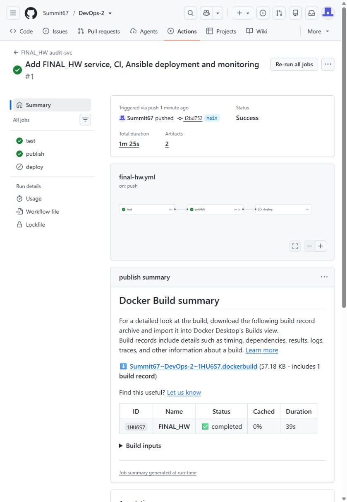
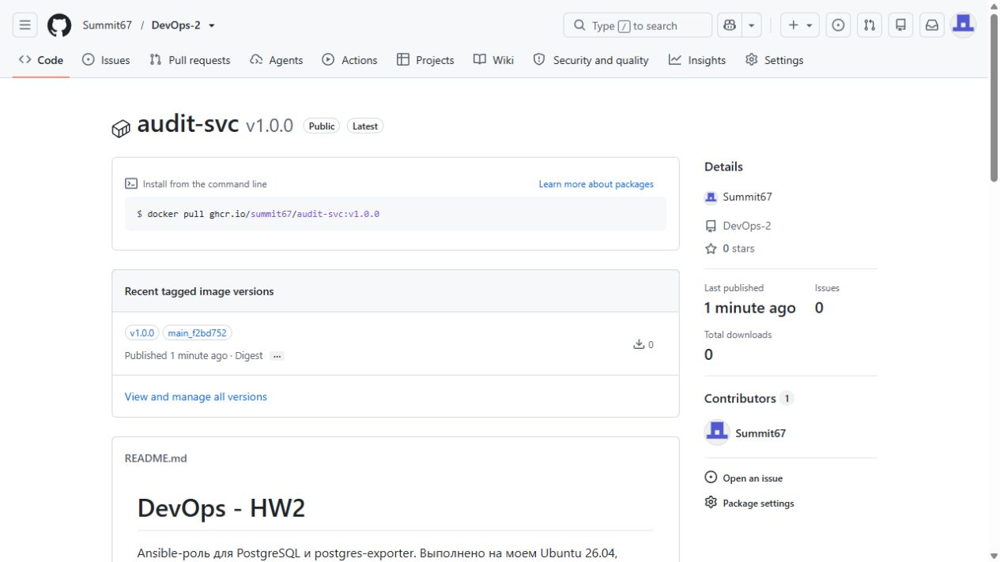
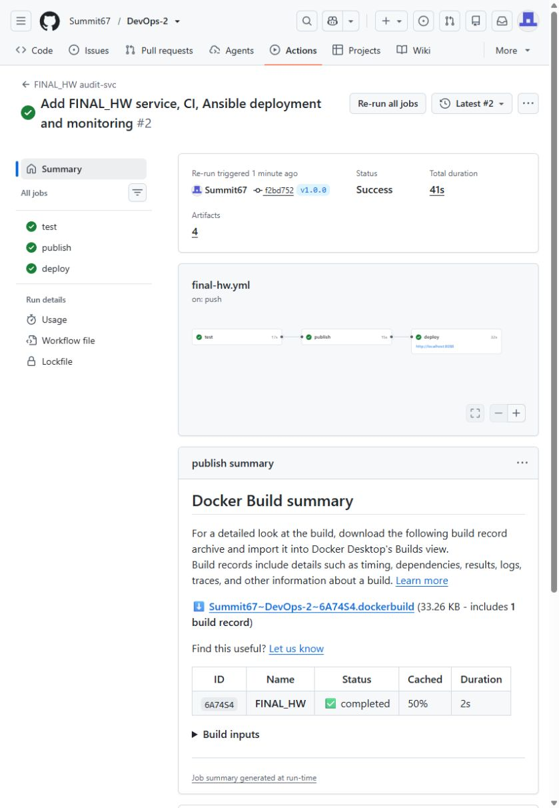
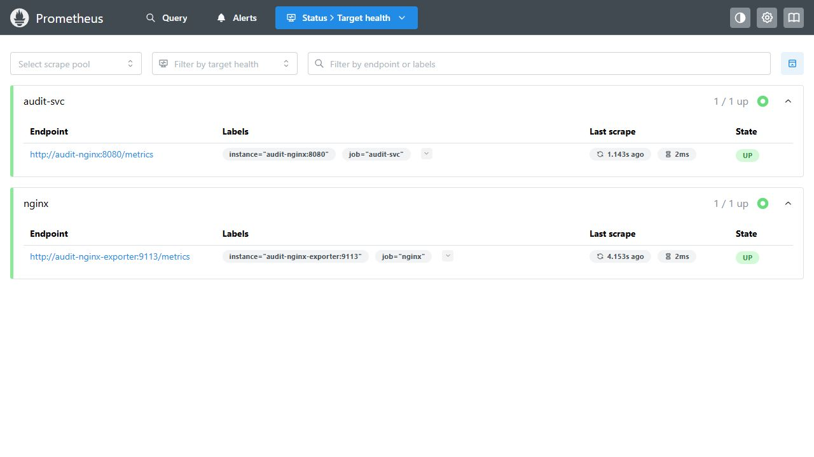
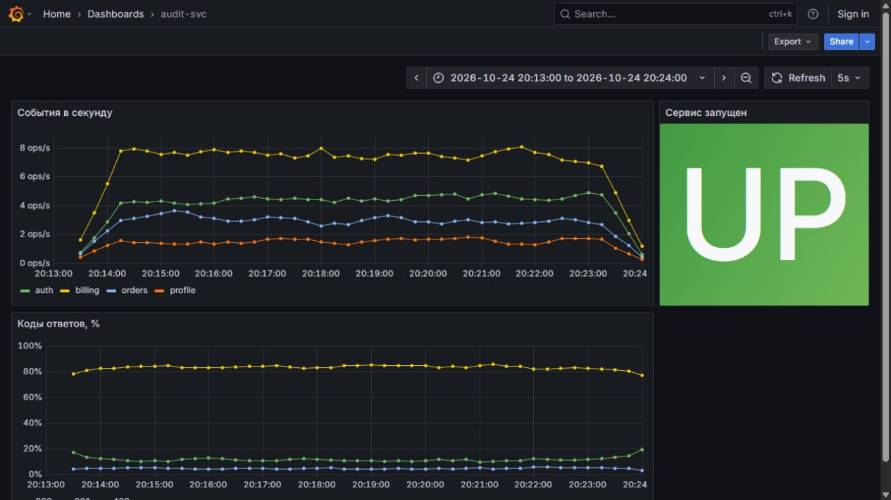
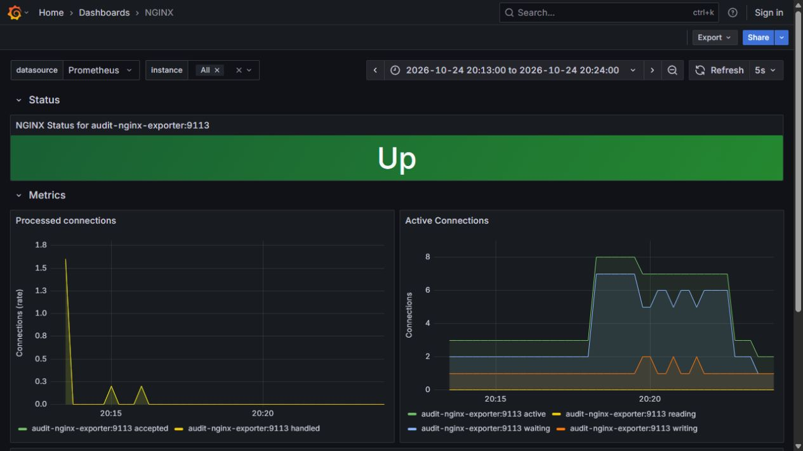
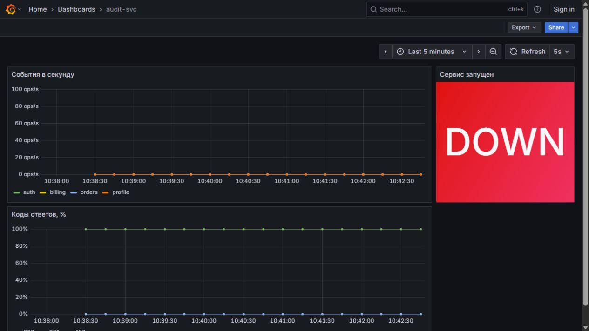
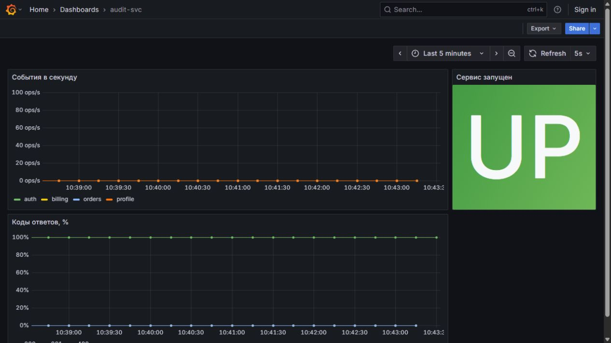

# FINAL_HW. audit-svc

Вариант 2: GitHub Actions + GHCR. Развёртывание и мониторинг — на Ubuntu в VMware.

## 1. CI и образ

[Workflow](../.github/workflows/final-hw.yml) · [Pipeline main](https://github.com/Summit67/DevOps-2/actions/runs/40114816546) · [GHCR](https://github.com/Summit67/DevOps-2/pkgs/container/audit-svc).

Команда (Bash):
```
poetry run pytest --junitxml=test-results.xml
```
Вывод (text):
```
============================= test session starts ==============================
platform linux -- Python 3.11.17, pytest-8.4.2, pluggy-1.6.0
rootdir: /home/runner/work/DevOps-2/DevOps-2/FINAL_HW
configfile: pyproject.toml
testpaths: tests
plugins: aiohttp-1.1.1, asyncio-0.24.0
asyncio: mode=Mode.AUTO, default_loop_scope=function
collected 6 items

tests/test_main.py::test_create_and_list_events 
-------------------------------- live log call ---------------------------------
INFO     aiohttp.access:web_log.py:229 127.0.0.1 [24/Oct/2026:17:09:33 +0000] "POST /api/events HTTP/1.1" 201 172 "-" "Python/3.11 aiohttp/3.14.4"
INFO     aiohttp.access:web_log.py:229 127.0.0.1 [24/Oct/2026:17:09:33 +0000] "GET /api/events?app=billing HTTP/1.1" 200 260 "-" "Python/3.11 aiohttp/3.14.4"
PASSED                                                                   [ 16%]
tests/test_main.py::test_invalid_event 
-------------------------------- live log call ---------------------------------
INFO     aiohttp.access:web_log.py:229 127.0.0.1 [24/Oct/2026:17:09:33 +0000] "POST /api/events HTTP/1.1" 400 230 "-" "Python/3.11 aiohttp/3.14.4"
INFO     aiohttp.access:web_log.py:229 127.0.0.1 [24/Oct/2026:17:09:33 +0000] "POST /api/events HTTP/1.1" 400 238 "-" "Python/3.11 aiohttp/3.14.4"
INFO     aiohttp.access:web_log.py:229 127.0.0.1 [24/Oct/2026:17:09:33 +0000] "POST /api/events HTTP/1.1" 400 218 "-" "Python/3.11 aiohttp/3.14.4"
INFO     aiohttp.access:web_log.py:229 127.0.0.1 [24/Oct/2026:17:09:33 +0000] "POST /api/events HTTP/1.1" 400 207 "-" "Python/3.11 aiohttp/3.14.4"
PASSED                                                                   [ 33%]
tests/test_main.py::test_metrics 
-------------------------------- live log call ---------------------------------
INFO     aiohttp.access:web_log.py:229 127.0.0.1 [24/Oct/2026:17:09:33 +0000] "POST /api/events HTTP/1.1" 201 172 "-" "Python/3.11 aiohttp/3.14.4"
INFO     aiohttp.access:web_log.py:229 127.0.0.1 [24/Oct/2026:17:09:33 +0000] "GET /metrics HTTP/1.1" 200 6159 "-" "Python/3.11 aiohttp/3.14.4"
PASSED                                                                   [ 50%]
tests/test_main.py::test_reload_reconnects_with_new_password 
-------------------------------- live log call ---------------------------------
INFO     audit_svc.main:main.py:162 config reloaded, database settings are unchanged
INFO     aiohttp.access:web_log.py:229 127.0.0.1 [24/Oct/2026:17:09:33 +0000] "POST /reload HTTP/1.1" 200 199 "-" "Python/3.11 aiohttp/3.14.4"
INFO     audit_svc.main:main.py:178 config reloaded, reconnected to the database
INFO     aiohttp.access:web_log.py:229 127.0.0.1 [24/Oct/2026:17:09:33 +0000] "POST /reload HTTP/1.1" 200 198 "-" "Python/3.11 aiohttp/3.14.4"
PASSED                                                                   [ 66%]
tests/test_main.py::test_reload_keeps_old_connection_on_failure 
-------------------------------- live log call ---------------------------------
ERROR    audit_svc.main:main.py:170 config reload failed, keeping previous connection: connection refused
INFO     aiohttp.access:web_log.py:229 127.0.0.1 [24/Oct/2026:17:09:33 +0000] "POST /reload HTTP/1.1" 503 241 "-" "Python/3.11 aiohttp/3.14.4"
INFO     aiohttp.access:web_log.py:229 127.0.0.1 [24/Oct/2026:17:09:33 +0000] "POST /api/events HTTP/1.1" 201 172 "-" "Python/3.11 aiohttp/3.14.4"
PASSED                                                                   [ 83%]
tests/test_main.py::test_database_down 
-------------------------------- live log call ---------------------------------
WARNING  audit_svc.main:main.py:57 database is unavailable, will retry on next request: connection refused
ERROR    audit_svc.main:main.py:78 database error: connection refused
INFO     aiohttp.access:web_log.py:229 127.0.0.1 [24/Oct/2026:17:09:33 +0000] "GET /healthz HTTP/1.1" 503 212 "-" "Python/3.11 aiohttp/3.14.4"
ERROR    audit_svc.main:main.py:78 database error: connection refused
INFO     aiohttp.access:web_log.py:229 127.0.0.1 [24/Oct/2026:17:09:33 +0000] "POST /api/events HTTP/1.1" 503 212 "-" "Python/3.11 aiohttp/3.14.4"
PASSED                                                                   [100%]

- generated xml file: /home/runner/work/DevOps-2/DevOps-2/FINAL_HW/test-results.xml -
============================== 6 passed in 0.06s ===============================
```
Команда (Bash):
```
/usr/bin/docker buildx build --build-arg SOURCE_DATE_EPOCH=1700000000 --cache-from type=gha --cache-to type=gha,mode=max --iidfile /home/runner/work/_temp/docker-actions-toolkit-mziDta/build-iidfile-4b635a0c74.txt --output type=image,rewrite-timestamp=true --attest type=provenance,disabled=true --attest type=sbom,disabled=true --tag ghcr.io/summit67/audit-svc:main_f2bd752 --metadata-file /home/runner/work/_temp/docker-actions-toolkit-mziDta/build-metadata-bc6b787d41.json --push FINAL_HW
```
Вывод (text):
```
#16 exporting manifest sha256:00840de2f74ebad6e08596c69934353aa0ae242413ed1b08b6e127a920a2c371 done
#16 exporting config sha256:f1d2a9f7aab1d66910728a96dbe754ac4b867b9f29413d5ba3c9482b297dd77b done
#16 pushing layers
#16 pushing layers 3.3s done
#16 pushing manifest for ghcr.io/summit67/audit-svc:main_f2bd752@sha256:00840de2f74ebad6e08596c69934353aa0ae242413ed1b08b6e127a920a2c371 0.4s done
  "containerimage.digest": "sha256:00840de2f74ebad6e08596c69934353aa0ae242413ed1b08b6e127a920a2c371",
```

Полные логи: [тесты](logs/main-test.txt), [публикация](logs/main-publish.txt). JUnit — артефакт `junit`.





## 2. PostgreSQL и секреты

Пароли находятся в зашифрованном [vault.yml](deploy/inventories/prom/group_vars/all/vault.yml). Ключ передаётся через секрет `ANSIBLE_VAULT_PASSWORD` окружения `final-hw` и скрипт `vault-pass.sh`. В задачах с паролями стоит `no_log: true`.

Команда (Bash):
```
head -n 1 deploy/inventories/prom/group_vars/all/vault.yml
```
Вывод (text):
```
$ANSIBLE_VAULT;1.1;AES256
```
Команда (Bash):
```
docker exec -u postgres audit-postgres psql -c "SELECT datname, pg_get_userbyid(datdba) AS owner FROM pg_database WHERE datname='audit';"
```
Вывод (text):
```
datname |   owner   
---------+-----------
 audit   | audit_svc
(1 row)
```
Команда (Bash):
```
docker volume inspect audit-postgres-data --format '{{.Name}} {{.Mountpoint}}'
```
Вывод (text):
```
audit-postgres-data /var/lib/docker/volumes/audit-postgres-data/_data
```
Команда (Bash):
```
docker exec audit-svc id
```
Вывод (text):
```
uid=10001(audit) gid=10001(audit) groups=10001(audit)
```
Команда (Bash):
```
sudo stat -c '%a %u:%g %n' /data/audit-svc/config/config.yaml
```
Вывод (text):
```
640 0:10001 /data/audit-svc/config/config.yaml
```

## 3. Deploy и смена пароля

Теги `v*` защищены ruleset; создавать их может администратор репозитория. Deploy запускается только для защищённого тега на runner `ubuntu-final-hw` с меткой `deploy`. Окружение `final-hw` разрешает только теги `v*`.

[Pipeline v1.0.0](https://github.com/Summit67/DevOps-2/actions/runs/40114953002).



Первый запуск:

Команда (Bash):
```
ansible-playbook audit-svc.play.yml --vault-password-file ./vault-pass.sh -e audit_image_tag=v1.0.0
```
Вывод (text):
```
PLAY [Deploy audit-svc] ********************************************************

TASK [Create backend network] **************************************************
changed: [vm1]

TASK [Create edge network] *****************************************************
changed: [vm1]

TASK [Create PostgreSQL volume] ************************************************
changed: [vm1]

TASK [Create configuration directories] ****************************************
changed: [vm1] => (item=config)
changed: [vm1] => (item=nginx)
changed: [vm1] => (item=postgres)

TASK [Write PostgreSQL superuser password] *************************************
changed: [vm1]

TASK [Start PostgreSQL 17] *****************************************************
changed: [vm1]

TASK [Get PostgreSQL container address] ****************************************
ok: [vm1]

TASK [Wait for PostgreSQL] *****************************************************
ok: [vm1]

TASK [Create or update audit_svc database user] ********************************
changed: [vm1]

TASK [Create audit database owned by audit_svc] ********************************
changed: [vm1]

TASK [Write application configuration] *****************************************
changed: [vm1]

TASK [Pull release image] ******************************************************
changed: [vm1]

TASK [Get release image ID] ****************************************************
ok: [vm1]

TASK [Apply database migrations before updating application] *******************
changed: [vm1]

TASK [Show migration result] ***************************************************
ok: [vm1] => {
    "migration.stderr_lines": [
        "[INFO] applying 0001_create_events",
        "[INFO] applying 0002_events_app_index",
        "[INFO] done: 2 applied, 0 already in place"
    ]
}

TASK [Start audit-svc from release image] **************************************
changed: [vm1]

TASK [Write Nginx configuration] ***********************************************
changed: [vm1]

TASK [Start Nginx] *************************************************************
changed: [vm1]

TASK [Start Nginx exporter] ****************************************************
changed: [vm1]

TASK [Apply configuration handlers] ********************************************

RUNNING HANDLER [Reload application configuration] *****************************
ok: [vm1]

RUNNING HANDLER [Reload Nginx] *************************************************
changed: [vm1]

TASK [Check application through Nginx] *****************************************
ok: [vm1]

PLAY RECAP *********************************************************************
vm1                        : ok=22   changed=16   unreachable=0    failed=0    skipped=0    rescued=0    ignored=0
```

Повторный запуск задачи CI:

Команда (Bash):
```
ansible-playbook audit-svc.play.yml --vault-password-file ./vault-pass.sh -e audit_image_tag=v1.0.0
```
Вывод (text):
```
PLAY [Deploy audit-svc] ********************************************************

TASK [Create backend network] **************************************************
ok: [vm1]

TASK [Create edge network] *****************************************************
ok: [vm1]

TASK [Create PostgreSQL volume] ************************************************
ok: [vm1]

TASK [Create configuration directories] ****************************************
ok: [vm1] => (item=config)
ok: [vm1] => (item=nginx)
ok: [vm1] => (item=postgres)

TASK [Write PostgreSQL superuser password] *************************************
ok: [vm1]

TASK [Start PostgreSQL 17] *****************************************************
ok: [vm1]

TASK [Get PostgreSQL container address] ****************************************
ok: [vm1]

TASK [Wait for PostgreSQL] *****************************************************
ok: [vm1]

TASK [Create or update audit_svc database user] ********************************
ok: [vm1]

TASK [Create audit database owned by audit_svc] ********************************
ok: [vm1]

TASK [Write application configuration] *****************************************
ok: [vm1]

TASK [Pull release image] ******************************************************
ok: [vm1]

TASK [Get release image ID] ****************************************************
ok: [vm1]

TASK [Apply database migrations before updating application] *******************
ok: [vm1]

TASK [Show migration result] ***************************************************
ok: [vm1] => {
    "migration.stderr_lines": [
        "[INFO] done: 0 applied, 2 already in place"
    ]
}

TASK [Start audit-svc from release image] **************************************
ok: [vm1]

TASK [Write Nginx configuration] ***********************************************
ok: [vm1]

TASK [Start Nginx] *************************************************************
ok: [vm1]

TASK [Start Nginx exporter] ****************************************************
ok: [vm1]

TASK [Apply configuration handlers] ********************************************

TASK [Check application through Nginx] *****************************************
ok: [vm1]

PLAY RECAP *********************************************************************
vm1                        : ok=20   changed=0    unreachable=0    failed=0    skipped=0    rescued=0    ignored=0
```

До смены пароля:

Команда (Bash):
```
printf 'StartedAt\n'
docker inspect -f '{{.State.StartedAt}}' audit-svc
printf 'Image ID\n'
docker inspect -f '{{.Image}}' audit-svc
printf 'Reload counter\n'
curl -fsS localhost:8088/metrics | grep '^audit_config_reloads_total' || true
printf 'Health\n'
curl -sS -w '\nHTTP %{http_code}\n' localhost:8088/healthz
```
Вывод (text):
```
StartedAt
2026-10-24T17:12:09.291411182Z
Image ID
sha256:00840de2f74ebad6e08596c69934353aa0ae242413ed1b08b6e127a920a2c371
Reload counter
audit_config_reloads_total{result="success"} 1.0
Health
{"status": "ok"}
HTTP 200
```

Пароль изменён [скриптом](deploy/rotate-password.py), который расшифровывает Vault в памяти и сохраняет обновлённый файл зашифрованным. Затем создан тег `v1.0.1`.

Команда (Bash):
```
python3 /home/devops/final-hw-work/FINAL_HW/deploy/rotate-password.py /home/devops/final-hw-private/vault-password
```
Вывод (text):
```
Updated encrypted vault_audit_password
```

[Pipeline v1.0.1](https://github.com/Summit67/DevOps-2/actions/runs/40115224802).

Команда (Bash):
```
ansible-playbook audit-svc.play.yml --vault-password-file ./vault-pass.sh -e audit_image_tag=v1.0.1
```
Вывод (text):
```
PLAY [Deploy audit-svc] ********************************************************

TASK [Create backend network] **************************************************
ok: [vm1]

TASK [Create edge network] *****************************************************
ok: [vm1]

TASK [Create PostgreSQL volume] ************************************************
ok: [vm1]

TASK [Create configuration directories] ****************************************
ok: [vm1] => (item=config)
ok: [vm1] => (item=nginx)
ok: [vm1] => (item=postgres)

TASK [Write PostgreSQL superuser password] *************************************
ok: [vm1]

TASK [Start PostgreSQL 17] *****************************************************
ok: [vm1]

TASK [Get PostgreSQL container address] ****************************************
ok: [vm1]

TASK [Wait for PostgreSQL] *****************************************************
ok: [vm1]

TASK [Create or update audit_svc database user] ********************************
changed: [vm1]

TASK [Create audit database owned by audit_svc] ********************************
ok: [vm1]

TASK [Write application configuration] *****************************************
changed: [vm1]

TASK [Pull release image] ******************************************************
changed: [vm1]

TASK [Get release image ID] ****************************************************
ok: [vm1]

TASK [Apply database migrations before updating application] *******************
ok: [vm1]

TASK [Show migration result] ***************************************************
ok: [vm1] => {
    "migration.stderr_lines": [
        "[INFO] done: 0 applied, 2 already in place"
    ]
}

TASK [Start audit-svc from release image] **************************************
ok: [vm1]

TASK [Write Nginx configuration] ***********************************************
ok: [vm1]

TASK [Start Nginx] *************************************************************
ok: [vm1]

TASK [Start Nginx exporter] ****************************************************
ok: [vm1]

TASK [Apply configuration handlers] ********************************************

RUNNING HANDLER [Reload application configuration] *****************************
changed: [vm1]

TASK [Check application through Nginx] *****************************************
ok: [vm1]

PLAY RECAP *********************************************************************
vm1                        : ok=21   changed=4    unreachable=0    failed=0    skipped=0    rescued=0    ignored=0
```
Команда (Bash):
```
printf 'StartedAt\n'
docker inspect -f '{{.State.StartedAt}}' audit-svc
printf 'Image ID\n'
docker inspect -f '{{.Image}}' audit-svc
printf 'Reload counter\n'
curl -fsS localhost:8088/metrics | grep '^audit_config_reloads_total'
printf 'Health\n'
curl -sS -w '\nHTTP %{http_code}\n' localhost:8088/healthz
printf 'Reload log\n'
docker logs audit-svc 2>&1 | grep 'config reload'
printf 'Release image IDs\n'
docker image inspect ghcr.io/summit67/audit-svc:v1.0.0 ghcr.io/summit67/audit-svc:v1.0.1 --format '{{.RepoTags}} {{.Id}}'
```
Вывод (text):
```
StartedAt
2026-10-24T17:12:09.291411182Z
Image ID
sha256:00840de2f74ebad6e08596c69934353aa0ae242413ed1b08b6e127a920a2c371
Reload counter
audit_config_reloads_total{result="success"} 2.0
Health
{"status": "ok"}
HTTP 200
Reload log
2026-10-24 17:12:12,926 [INFO] audit_svc.main: config reloaded, database settings are unchanged
2026-10-24 17:15:52,472 [INFO] audit_svc.main: config reloaded, reconnected to the database
Release image IDs
[ghcr.io/summit67/audit-svc:v1.0.0 ghcr.io/summit67/audit-svc:v1.0.1] sha256:00840de2f74ebad6e08596c69934353aa0ae242413ed1b08b6e127a920a2c371
[ghcr.io/summit67/audit-svc:v1.0.0 ghcr.io/summit67/audit-svc:v1.0.1] sha256:00840de2f74ebad6e08596c69934353aa0ae242413ed1b08b6e127a920a2c371
```

`StartedAt` и Image ID не изменились. Счётчик reload вырос с 1 до 2, health — 200. Конфиг смонтирован каталогом; Ansible заменяет файл, хендлер вызывает `/reload`. Образ закреплён digest, время сборки — `SOURCE_DATE_EPOCH`, создание `pyc` отключено.

## 4. Nginx и exporter

Команда (Bash):
```
printf 'Health\n'
curl -sS -w '\nHTTP %{http_code}\n' localhost:8088/healthz
printf 'Reload log count before\n'
docker logs audit-svc 2>&1 | grep -c 'config reload' || true
for path in '/reload' '/reload?x=1' '//reload' '/%72eload'; do
 printf '%s ' "$path"
 curl -s -o /dev/null -w '%{http_code}\n' -X POST "localhost:8088$path"
done
printf 'Reload log count after\n'
docker logs audit-svc 2>&1 | grep -c 'config reload' || true
printf 'stub_status on main port\n'
curl -s -o /dev/null -w '%{http_code}\n' localhost:8088/stub_status
printf 'Exporter\n'
curl -fsS localhost:9113/metrics | grep '^nginx_up '
printf 'Container ports\n'
docker ps --filter name=audit --format '{{.Names}}\t{{.Ports}}'
```
Вывод (text):
```
Health
{"status": "ok"}
HTTP 200
Reload log count before
1
/reload 404
/reload?x=1 404
//reload 404
/%72eload 404
Reload log count after
1
stub_status on main port
404
Exporter
nginx_up 1
Container ports
audit-load	8080/tcp
audit-nginx-exporter	127.0.0.1:9113->9113/tcp
audit-nginx	80/tcp, 127.0.0.1:8088->8080/tcp
audit-svc	8080/tcp
audit-postgres	5432/tcp
```

`8080/tcp` и `5432/tcp` без адреса хоста означают EXPOSE: эти порты не опубликованы.

## 5. Мониторинг

Команда (Bash):
```
cd /home/devops/final-hw-work/FINAL_HW/monitoring
docker compose up -d
docker run -d --name audit-load --memory 128m --network audit-edge ghcr.io/summit67/audit-svc:v1.0.0 generate --url http://audit-nginx:8080 --duration 600
date --iso-8601=seconds
```
Вывод (text):
```
108d09c5a1dc5543f589368e9182052945a0329b8824129f2fdff64a83119d82
2026-10-24T20:13:11+03:00
 Network final-monitoring_monitoring  Creating
 Network final-monitoring_monitoring  Created
 Volume final-monitoring_prometheus-data  Creating
 Volume final-monitoring_prometheus-data  Created
 Volume final-monitoring_grafana-data  Creating
 Volume final-monitoring_grafana-data  Created
 Container final-monitoring-prometheus-1  Creating
 Container final-monitoring-grafana-1  Creating
 Container final-monitoring-grafana-1  Created
 Container final-monitoring-prometheus-1  Created
 Container final-monitoring-grafana-1  Starting
 Container final-monitoring-prometheus-1  Starting
 Container final-monitoring-grafana-1  Started
 Container final-monitoring-prometheus-1  Started
```

Результат нагрузки и проверка целей:

Команда (Bash):
```
printf 'Load result\n'
docker logs audit-load --tail 5 2>&1
printf 'Load times\n'
docker inspect audit-load --format 'StartedAt={{.State.StartedAt}} FinishedAt={{.State.FinishedAt}} ExitCode={{.State.ExitCode}}'
printf 'Migrations\n'
docker exec -u postgres audit-postgres psql -d audit -c 'SELECT version FROM schema_migrations ORDER BY version;'
printf 'Actor index\n'
docker exec -u postgres audit-postgres psql -d audit -c "SELECT indexname, indexdef FROM pg_indexes WHERE indexname='events_actor_idx';"
printf 'Targets\n'
curl -fsS localhost:19091/api/v1/targets | python3 -c 'import json,sys; d=json.load(sys.stdin); [print(t["labels"]["job"], t["scrapeUrl"], t["health"]) for t in d["data"]["activeTargets"]]'
printf 'Response code percentages during load\n'
curl -fsSG localhost:19091/api/v1/query --data-urlencode 'query=100 * sum by (code) (rate(audit_http_requests_total{job="audit-svc"}[1m])) / scalar(sum(rate(audit_http_requests_total{job="audit-svc"}[1m])))' --data-urlencode 'time=2026-10-24T17:22:00Z' | python3 -c 'import json,sys; d=json.load(sys.stdin); v=d["data"]["result"]; [print(r["metric"]["code"], r["value"][1]) for r in v]; print("sum:",sum(float(r["value"][1]) for r in v))'
printf 'Health\n'
curl -sS -w '\nHTTP %{http_code}\n' localhost:8088/healthz
```
Вывод (text):
```
Load result
sent 11045: {'200': 1148, '201': 9334, '400': 539, '502': 24}
sent 11242: {'200': 1169, '201': 9501, '400': 548, '502': 24}
sent 11440: {'200': 1198, '201': 9657, '400': 561, '502': 24}
sent 11637: {'200': 1217, '201': 9824, '400': 572, '502': 24}
total 11809: {'200': 1241, '201': 9966, '400': 578, '502': 24}
Load times
StartedAt=2026-10-24T17:13:10.914185845Z FinishedAt=2026-10-24T17:23:12.676965274Z ExitCode=0
Migrations
         version         
-------------------------
 0001_create_events
 0002_events_app_index
 0003_events_actor_index
(3 rows)

Actor index
    indexname     |                              indexdef                              
------------------+--------------------------------------------------------------------
 events_actor_idx | CREATE INDEX events_actor_idx ON public.events USING btree (actor)
(1 row)

Targets
audit-svc http://audit-nginx:8080/metrics up
nginx http://audit-nginx-exporter:9113/metrics up
Response code percentages during load
200 12.271062271062272
201 81.95970695970695
400 5.769230769230769
sum: 99.99999999999999
Health
{"status": "ok"}
HTTP 200
```

Нагрузка выполнялась 600 секунд. Во время обновления до `v1.0.2` контейнер был пересоздан; в результате нагрузки есть 24 ответа 502. Проценты на панели считаются по ответам приложения, поэтому ответы Nginx 502 в эту метрику не входят.







JSON: [audit-svc](monitoring/grafana/audit-svc.json), [Nginx](monitoring/grafana/nginx.json). Дашборд Nginx взят из [репозитория exporter](https://github.com/nginx/nginx-prometheus-exporter/blob/main/grafana/dashboard.json).

Запросы панелей:

События в секунду:
```
sum by (app) (rate(audit_events_received_total{job="audit-svc"}[1m]))
```
Коды ответов, %:
```
100 * sum by (code) (rate(audit_http_requests_total{job="audit-svc"}[1m])) / scalar(sum(rate(audit_http_requests_total{job="audit-svc"}[1m])))
```
Сервис запущен:
```
up{job="audit-svc"}
```

Проверка DOWN:

Команда (Bash):
```
docker stop audit-svc
sleep 8
curl -fsSG localhost:19091/api/v1/query --data-urlencode 'query=up{job="audit-svc"}'
printf '\n'
```
Вывод (text):
```
audit-svc
{"status":"success","data":{"resultType":"vector","result":[{"metric":{"__name__":"up","instance":"audit-nginx:8080","job":"audit-svc"},"value":[1792914157.953,"0"]}]}}
```



Запуск обратно:

Команда (Bash):
```
docker start audit-svc
sleep 8
curl -fsSG localhost:19091/api/v1/query --data-urlencode 'query=up{job="audit-svc"}'
printf '\n'
curl -sS -w '\nHTTP %{http_code}\n' localhost:8088/healthz
```
Вывод (text):
```
audit-svc
{"status":"success","data":{"resultType":"vector","result":[{"metric":{"__name__":"up","instance":"audit-nginx:8080","job":"audit-svc"},"value":[1792914182.402,"1"]}]}}
{"status": "ok"}
HTTP 200
```



## 6. Миграция 0003

[Pipeline v1.0.2](https://github.com/Summit67/DevOps-2/actions/runs/40115386094).

Команда (Bash):
```
ansible-playbook audit-svc.play.yml --vault-password-file ./vault-pass.sh -e audit_image_tag=v1.0.2
```
Вывод (text):
```
PLAY [Deploy audit-svc] ********************************************************

TASK [Create backend network] **************************************************
ok: [vm1]

TASK [Create edge network] *****************************************************
ok: [vm1]

TASK [Create PostgreSQL volume] ************************************************
ok: [vm1]

TASK [Create configuration directories] ****************************************
ok: [vm1] => (item=config)
ok: [vm1] => (item=nginx)
ok: [vm1] => (item=postgres)

TASK [Write PostgreSQL superuser password] *************************************
ok: [vm1]

TASK [Start PostgreSQL 17] *****************************************************
ok: [vm1]

TASK [Get PostgreSQL container address] ****************************************
ok: [vm1]

TASK [Wait for PostgreSQL] *****************************************************
ok: [vm1]

TASK [Create or update audit_svc database user] ********************************
ok: [vm1]

TASK [Create audit database owned by audit_svc] ********************************
ok: [vm1]

TASK [Write application configuration] *****************************************
ok: [vm1]

TASK [Pull release image] ******************************************************
changed: [vm1]

TASK [Get release image ID] ****************************************************
ok: [vm1]

TASK [Apply database migrations before updating application] *******************
changed: [vm1]

TASK [Show migration result] ***************************************************
ok: [vm1] => {
    "migration.stderr_lines": [
        "[INFO] applying 0003_events_actor_index",
        "[INFO] done: 1 applied, 2 already in place"
    ]
}

TASK [Start audit-svc from release image] **************************************
changed: [vm1]

TASK [Write Nginx configuration] ***********************************************
ok: [vm1]

TASK [Start Nginx] *************************************************************
ok: [vm1]

TASK [Start Nginx exporter] ****************************************************
ok: [vm1]

TASK [Apply configuration handlers] ********************************************

TASK [Check application through Nginx] *****************************************
ok: [vm1]

PLAY RECAP *********************************************************************
vm1                        : ok=20   changed=3    unreachable=0    failed=0    skipped=0    rescued=0    ignored=0
```

Миграция запускается перед задачей обновления контейнера. При ненулевом коде завершения Ansible останавливает плейбук. Повторный запуск на `v1.0.0` выше: `0 applied, 2 already in place`.
