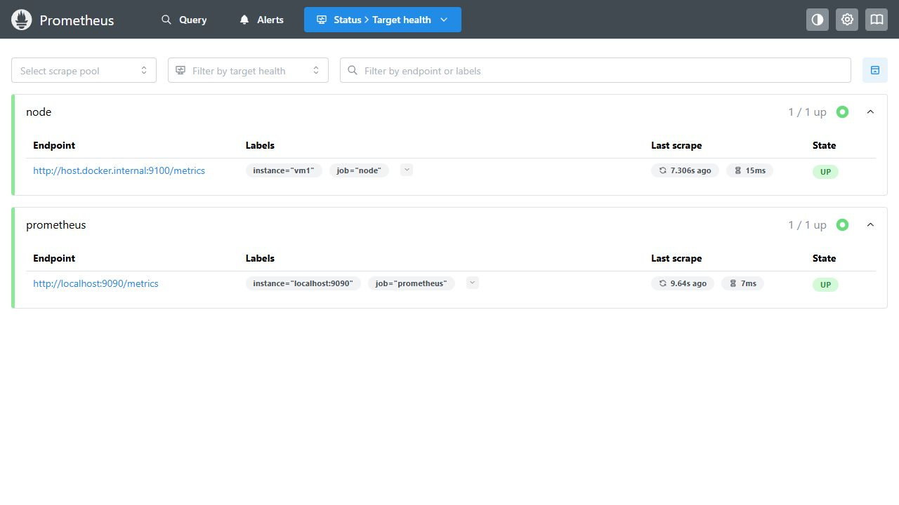
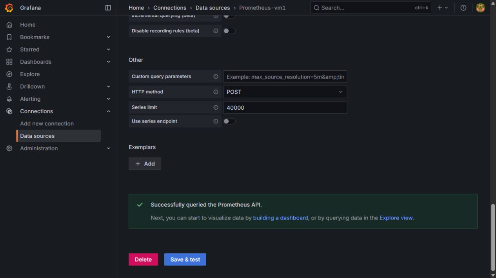
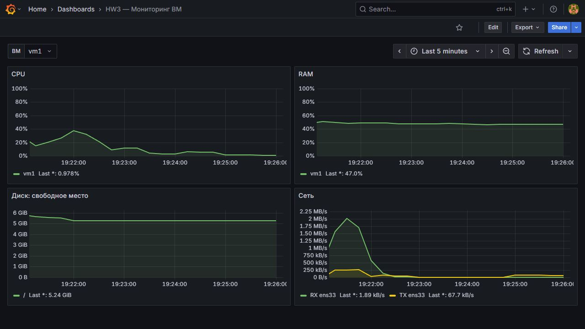

# HW3 — Мониторинг и Docker

[Репозиторий](https://github.com/Summit67/DevOps-2/tree/main/HW3)

ВМ: Ubuntu 26.04. Рабочая папка: /home/devops/DevOps-2/HW3.

## 1. Мониторинг

Команда (Bash):
```
cd monitoring && sudo docker compose -p hw3-monitoring up -d && sudo docker compose -p hw3-monitoring ps
```
Вывод (text):
```
 Container hw3-monitoring-node-exporter-1  Running
 Container hw3-monitoring-grafana-1  Recreate
 Container hw3-monitoring-prometheus-1  Running
 Container hw3-monitoring-grafana-1  Recreated
 Container hw3-monitoring-grafana-1  Starting
 Container hw3-monitoring-grafana-1  Started
NAME                             IMAGE                       COMMAND                  SERVICE         CREATED         STATUS                  PORTS
hw3-monitoring-grafana-1         grafana/grafana:12.1.0      "/run.sh"                grafana         1 second ago    Up Less than a second   127.0.0.1:3000->3000/tcp
hw3-monitoring-node-exporter-1   prom/node-exporter:v1.9.1   "/bin/node_exporter …"   node-exporter   3 minutes ago   Up 3 minutes            
hw3-monitoring-prometheus-1      prom/prometheus:v3.5.0      "/bin/prometheus --c…"   prometheus      3 minutes ago   Up 3 minutes            127.0.0.1:9090->9090/tcp
```

Команда (Bash):
```
cat monitoring/prometheus/prometheus.yml
```
Вывод (text):
```
global:
  scrape_interval: 15s
  evaluation_interval: 15s

scrape_configs:
  - job_name: prometheus
    static_configs:
      - targets: [localhost:9090]
  - job_name: node
    static_configs:
      - targets: [host.docker.internal:9100]
        labels:
          instance: vm1
```

Команда (Bash):
```
cd monitoring && sudo docker compose -p hw3-monitoring exec -T prometheus promtool check config /etc/prometheus/prometheus.yml
```
Вывод (text):
```
Checking /etc/prometheus/prometheus.yml
 SUCCESS: /etc/prometheus/prometheus.yml is valid prometheus config file syntax
```

Команда (Bash):
```
curl -fsS http://localhost:9100/metrics | grep -E '^node_(cpu_seconds_total|memory_MemAvailable_bytes|filesystem_avail_bytes|network_receive_bytes_total)' | sed -n '1,12p'
```
Вывод (text):
```
node_cpu_seconds_total{cpu="0",mode="idle"} 559.37
node_cpu_seconds_total{cpu="0",mode="iowait"} 2.67
node_cpu_seconds_total{cpu="0",mode="irq"} 0
node_cpu_seconds_total{cpu="0",mode="nice"} 1.74
node_cpu_seconds_total{cpu="0",mode="softirq"} 1.61
node_cpu_seconds_total{cpu="0",mode="steal"} 0
node_cpu_seconds_total{cpu="0",mode="system"} 26.78
node_cpu_seconds_total{cpu="0",mode="user"} 37.61
node_cpu_seconds_total{cpu="1",mode="idle"} 559.47
node_cpu_seconds_total{cpu="1",mode="iowait"} 2.83
node_cpu_seconds_total{cpu="1",mode="irq"} 0
node_cpu_seconds_total{cpu="1",mode="nice"} 1.11
```

Команда (Bash):
```
curl -fsSG http://localhost:9090/api/v1/query --data-urlencode 'query=up{job="node",instance="vm1"}' | python3 -m json.tool
```
Вывод (text):
```
{
    "status": "success",
    "data": {
        "resultType": "vector",
        "result": [
            {
                "metric": {
                    "__name__": "up",
                    "instance": "vm1",
                    "job": "node"
                },
                "value": [
                    1792686237.774,
                    "1"
                ]
            }
        ]
    }
}
```

Команда (Bash):
```
curl -fsS http://localhost:3000/api/health | python3 -m json.tool
```
Вывод (text):
```
{
    "database": "ok",
    "version": "12.1.0",
    "commit": "ccd7b6ce7ea6184b8c7eb1de044174147dd9a648"
}
```

Команда (Bash):
```
curl -fsS -u admin:admin http://localhost:3000/api/datasources/uid/cg20g291w46wwc/health | python3 -m json.tool
```
Вывод (text):
```
{
    "details": {
        "application": "Prometheus",
        "features": {
            "rulerApiEnabled": false
        }
    },
    "message": "Successfully queried the Prometheus API.",
    "status": "OK"
}
```

Команда (Bash):
```
python3 - <<'PY'
import json
d = json.load(open('monitoring/grafana/dashboard.json'))
print('Dashboard:', d['title'])
print('Variables:', ', '.join(v['name'] for v in d['templating']['list']))
for panel in d['panels']:
    print(panel['title'], '|', panel['fieldConfig']['defaults']['unit'])
    for target in panel['targets']:
        print(target['expr'])
PY
```
Вывод (text):
```
Dashboard: HW3 — Мониторинг ВМ
Variables: instance
CPU | percent
100 * (1 - avg by (instance) (rate(node_cpu_seconds_total{instance=~"$instance",mode="idle"}[$__rate_interval])))
RAM | percent
100 * (1 - node_memory_MemAvailable_bytes{instance=~"$instance"} / node_memory_MemTotal_bytes{instance=~"$instance"})
Диск: свободное место | bytes
node_filesystem_avail_bytes{instance=~"$instance",fstype!~"tmpfs|overlay|squashfs",mountpoint!~"/run.*|/var/lib/docker.*"}
Сеть | Bps
rate(node_network_receive_bytes_total{instance=~"$instance",device!~"lo|veth.*|docker.*|br-.*"}[$__rate_interval])
rate(node_network_transmit_bytes_total{instance=~"$instance",device!~"lo|veth.*|docker.*|br-.*"}[$__rate_interval])
```

### Prometheus: Targets



### Grafana: Save & test



### Дашборд



[JSON из Export → Export as JSON](monitoring/grafana/dashboard.json). Переменная instance — vm1. Конфигурация provisioning сохранена в monitoring/grafana/provisioning.

## 2. Docker

Базовый образ: python:3.11.6-slim-bookworm. Poetry 1.8.5 и poetry-plugin-export 1.8.0 закреплены для команды export. Исходники counter-backend и poetry.lock взяты из HW3 без изменения.

### Подготовка сборщика

Команда (Bash):
```
cd counter-backend && sudo docker build --progress=plain -f Dockerfile.single -t counter-backend:single .
```
Вывод (text):
```
DEPRECATED: The legacy builder is deprecated and will be removed in a future release.
            Install the buildx component to build images with BuildKit:
            https://docs.docker.com/go/buildx/

unknown flag: --progress

Usage:  docker build [OPTIONS] PATH | URL | -

Run 'docker build --help' for more information
```

Команда (Bash):
```
sudo apt-get install -y docker-buildx
```
Вывод (text):
```
Reading package lists...
Building dependency tree...
Reading state information...
Solving dependencies...
The following NEW packages will be installed:
  docker-buildx
0 upgraded, 1 newly installed, 0 to remove and 185 not upgraded.
Need to get 16.8 MB of archives.
After this operation, 71.0 MB of additional disk space will be used.
Get:1 http://nl.archive.ubuntu.com/ubuntu resolute/universe amd64 docker-buildx amd64 0.30.1-0ubuntu1 [16.8 MB]
debconf: unable to initialize frontend: Dialog
debconf: (Dialog frontend will not work on a dumb terminal, an emacs shell buffer, or without a controlling terminal.)
debconf: falling back to frontend: Readline
debconf: unable to initialize frontend: Readline
debconf: (This frontend requires a controlling tty.)
debconf: falling back to frontend: Teletype
debconf: unable to initialize frontend: Teletype
debconf: (This frontend requires a controlling tty.)
debconf: falling back to frontend: Noninteractive
Fetched 16.8 MB in 7s (2,459 kB/s)
Selecting previously unselected package docker-buildx.
(Reading database… 
(Reading database… 5%
(Reading database… 10%
(Reading database… 15%
(Reading database… 20%
(Reading database… 25%
(Reading database… 30%
(Reading database… 35%
(Reading database… 40%
(Reading database… 45%
(Reading database… 50%
(Reading database… 55%
(Reading database… 60%
(Reading database… 65%
(Reading database… 70%
(Reading database… 75%
(Reading database… 80%
(Reading database… 85%
(Reading database… 90%
(Reading database… 95%
(Reading database… 100%
(Reading database… 184322 files and directories currently installed.)
Preparing to unpack …/docker-buildx_0.30.1-0ubuntu1_amd64.deb…
Unpacking docker-buildx (0.30.1-0ubuntu1)…
Setting up docker-buildx (0.30.1-0ubuntu1)…
```

### Dockerfile.single

Команда (Bash):
```
cd counter-backend && sudo docker build --progress=plain -f Dockerfile.single -t counter-backend:single .
```
Вывод (text):
```
#0 building with "default" instance using docker driver

#1 [internal] load build definition from Dockerfile.single
#1 transferring dockerfile: 1.10kB done
#1 DONE 0.0s

#2 [internal] load metadata for docker.io/library/python:3.11.6-slim-bookworm
#2 DONE 3.7s

#3 [internal] load .dockerignore
#3 transferring context: 88B done
#3 DONE 0.0s

#4 [internal] load build context
#4 transferring context: 90.92kB 0.0s done
#4 DONE 0.0s

#5 [1/8] FROM docker.io/library/python:3.11.6-slim-bookworm@sha256:cc758519481092eb5a4a5ab0c1b303e288880d59afc601958d19e95b300bc86b
#5 resolve docker.io/library/python:3.11.6-slim-bookworm@sha256:cc758519481092eb5a4a5ab0c1b303e288880d59afc601958d19e95b300bc86b 0.0s done
#5 sha256:848d19a36773ad77a8144dab4d0f16d8c7a7704c58c0f91d1b7c06bd662c2673 0B / 3.19MB 0.2s
#5 sha256:4bfbe15b3e0135fc110b1a7b2dcecc2d9564b611698e7a9c36cb28774d0b1581 0B / 233B 0.2s
#5 sha256:c3aa3af0d5819a2242bfec83abe997d35d5d295c8f3ef3fc40d2ce1ac796b1bd 0B / 12.83MB 0.2s
#5 sha256:442c5d63eafd969b755d7c8e0914319677ca8d5112a84e851b16677a4fc1d189 0B / 3.32MB 0.2s
#5 sha256:848d19a36773ad77a8144dab4d0f16d8c7a7704c58c0f91d1b7c06bd662c2673 2.10MB / 3.19MB 1.1s
#5 sha256:4bfbe15b3e0135fc110b1a7b2dcecc2d9564b611698e7a9c36cb28774d0b1581 233B / 233B 1.0s done
#5 sha256:848d19a36773ad77a8144dab4d0f16d8c7a7704c58c0f91d1b7c06bd662c2673 3.19MB / 3.19MB 1.1s done
#5 sha256:1f7ce2fa46ab3942feabee654933948821303a5a821789dddab2d8c3df59e227 0B / 29.15MB 0.2s
#5 sha256:1f7ce2fa46ab3942feabee654933948821303a5a821789dddab2d8c3df59e227 3.15MB / 29.15MB 0.6s
#5 sha256:442c5d63eafd969b755d7c8e0914319677ca8d5112a84e851b16677a4fc1d189 1.05MB / 3.32MB 1.7s
#5 sha256:1f7ce2fa46ab3942feabee654933948821303a5a821789dddab2d8c3df59e227 6.29MB / 29.15MB 0.8s
#5 sha256:c3aa3af0d5819a2242bfec83abe997d35d5d295c8f3ef3fc40d2ce1ac796b1bd 1.05MB / 12.83MB 2.0s
#5 sha256:1f7ce2fa46ab3942feabee654933948821303a5a821789dddab2d8c3df59e227 8.39MB / 29.15MB 0.9s
#5 sha256:442c5d63eafd969b755d7c8e0914319677ca8d5112a84e851b16677a4fc1d189 2.10MB / 3.32MB 2.0s
#5 sha256:1f7ce2fa46ab3942feabee654933948821303a5a821789dddab2d8c3df59e227 10.49MB / 29.15MB 1.1s
#5 sha256:442c5d63eafd969b755d7c8e0914319677ca8d5112a84e851b16677a4fc1d189 3.32MB / 3.32MB 2.2s done
#5 sha256:1f7ce2fa46ab3942feabee654933948821303a5a821789dddab2d8c3df59e227 12.58MB / 29.15MB 1.2s
#5 sha256:1f7ce2fa46ab3942feabee654933948821303a5a821789dddab2d8c3df59e227 14.68MB / 29.15MB 1.4s
#5 sha256:1f7ce2fa46ab3942feabee654933948821303a5a821789dddab2d8c3df59e227 16.78MB / 29.15MB 1.5s
#5 sha256:c3aa3af0d5819a2242bfec83abe997d35d5d295c8f3ef3fc40d2ce1ac796b1bd 2.10MB / 12.83MB 2.6s
#5 sha256:1f7ce2fa46ab3942feabee654933948821303a5a821789dddab2d8c3df59e227 18.87MB / 29.15MB 1.7s
#5 sha256:1f7ce2fa46ab3942feabee654933948821303a5a821789dddab2d8c3df59e227 22.02MB / 29.15MB 1.8s
#5 sha256:1f7ce2fa46ab3942feabee654933948821303a5a821789dddab2d8c3df59e227 24.12MB / 29.15MB 2.0s
#5 sha256:c3aa3af0d5819a2242bfec83abe997d35d5d295c8f3ef3fc40d2ce1ac796b1bd 3.15MB / 12.83MB 3.0s
#5 sha256:1f7ce2fa46ab3942feabee654933948821303a5a821789dddab2d8c3df59e227 26.21MB / 29.15MB 2.1s
#5 sha256:1f7ce2fa46ab3942feabee654933948821303a5a821789dddab2d8c3df59e227 29.15MB / 29.15MB 2.3s
#5 sha256:c3aa3af0d5819a2242bfec83abe997d35d5d295c8f3ef3fc40d2ce1ac796b1bd 4.19MB / 12.83MB 3.5s
#5 sha256:1f7ce2fa46ab3942feabee654933948821303a5a821789dddab2d8c3df59e227 29.15MB / 29.15MB 2.3s done
#5 extracting sha256:1f7ce2fa46ab3942feabee654933948821303a5a821789dddab2d8c3df59e227
#5 sha256:c3aa3af0d5819a2242bfec83abe997d35d5d295c8f3ef3fc40d2ce1ac796b1bd 5.24MB / 12.83MB 3.8s
#5 extracting sha256:1f7ce2fa46ab3942feabee654933948821303a5a821789dddab2d8c3df59e227 0.8s done
#5 sha256:c3aa3af0d5819a2242bfec83abe997d35d5d295c8f3ef3fc40d2ce1ac796b1bd 7.34MB / 12.83MB 4.2s
#5 extracting sha256:442c5d63eafd969b755d7c8e0914319677ca8d5112a84e851b16677a4fc1d189 0.1s done
#5 sha256:c3aa3af0d5819a2242bfec83abe997d35d5d295c8f3ef3fc40d2ce1ac796b1bd 8.39MB / 12.83MB 4.5s
#5 sha256:c3aa3af0d5819a2242bfec83abe997d35d5d295c8f3ef3fc40d2ce1ac796b1bd 9.44MB / 12.83MB 4.8s
#5 sha256:c3aa3af0d5819a2242bfec83abe997d35d5d295c8f3ef3fc40d2ce1ac796b1bd 10.49MB / 12.83MB 5.0s
#5 sha256:c3aa3af0d5819a2242bfec83abe997d35d5d295c8f3ef3fc40d2ce1ac796b1bd 11.53MB / 12.83MB 5.3s
#5 sha256:c3aa3af0d5819a2242bfec83abe997d35d5d295c8f3ef3fc40d2ce1ac796b1bd 12.58MB / 12.83MB 5.4s
#5 sha256:c3aa3af0d5819a2242bfec83abe997d35d5d295c8f3ef3fc40d2ce1ac796b1bd 12.83MB / 12.83MB 5.4s done
#5 extracting sha256:c3aa3af0d5819a2242bfec83abe997d35d5d295c8f3ef3fc40d2ce1ac796b1bd
#5 extracting sha256:c3aa3af0d5819a2242bfec83abe997d35d5d295c8f3ef3fc40d2ce1ac796b1bd 0.3s done
#5 DONE 5.7s

#5 [1/8] FROM docker.io/library/python:3.11.6-slim-bookworm@sha256:cc758519481092eb5a4a5ab0c1b303e288880d59afc601958d19e95b300bc86b
#5 extracting sha256:4bfbe15b3e0135fc110b1a7b2dcecc2d9564b611698e7a9c36cb28774d0b1581 0.0s done
#5 extracting sha256:848d19a36773ad77a8144dab4d0f16d8c7a7704c58c0f91d1b7c06bd662c2673 0.1s done
#5 DONE 5.9s

#6 [2/8] RUN python -m pip install     --no-color --no-cache-dir --disable-pip-version-check     --no-python-version-warning --no-warn-script-location     --break-system-packages --progress-bar off     poetry==1.8.5 poetry-plugin-export==1.8.0 setuptools wheel
#6 2.097 Collecting poetry==1.8.5
#6 2.098   Obtaining dependency information for poetry==1.8.5 from https://files.pythonhosted.org/packages/45/8e/5e6cbfd7654c93b08423fc62be737a79121fb30ad44e3d9c00292c93fcbb/poetry-1.8.5-py3-none-any.whl.metadata
#6 2.554   Downloading poetry-1.8.5-py3-none-any.whl.metadata (6.9 kB)
#6 2.652 Collecting poetry-plugin-export==1.8.0
#6 2.653   Obtaining dependency information for poetry-plugin-export==1.8.0 from https://files.pythonhosted.org/packages/de/55/1dd7c8c955d71f58a9202c37bf8e037d697dc9f11a9a2ade65663251ee44/poetry_plugin_export-1.8.0-py3-none-any.whl.metadata
#6 2.738   Downloading poetry_plugin_export-1.8.0-py3-none-any.whl.metadata (2.8 kB)
#6 2.755 Requirement already satisfied: setuptools in /usr/local/lib/python3.11/site-packages (65.5.1)
#6 2.756 Requirement already satisfied: wheel in /usr/local/lib/python3.11/site-packages (0.42.0)
#6 2.907 Collecting build<2.0.0,>=1.0.3 (from poetry==1.8.5)
#6 2.908   Obtaining dependency information for build<2.0.0,>=1.0.3 from https://files.pythonhosted.org/packages/ad/9b/9fb3585dabcd73a1b2a6267f63f62649347c9e6d072c9fde365b105abb2c/build-1.6.1-py3-none-any.whl.metadata
#6 3.003   Downloading build-1.6.1-py3-none-any.whl.metadata (5.6 kB)
#6 3.128 Collecting cachecontrol[filecache]<0.15.0,>=0.14.0 (from poetry==1.8.5)
#6 3.128   Obtaining dependency information for cachecontrol[filecache]<0.15.0,>=0.14.0 from https://files.pythonhosted.org/packages/ef/79/c45f2d53efe6ada1110cf6f9fca095e4ff47a0454444aefdde6ac4789179/cachecontrol-0.14.4-py3-none-any.whl.metadata
#6 3.241   Downloading cachecontrol-0.14.4-py3-none-any.whl.metadata (3.1 kB)
#6 3.364 Collecting cleo<3.0.0,>=2.1.0 (from poetry==1.8.5)
#6 3.364   Obtaining dependency information for cleo<3.0.0,>=2.1.0 from https://files.pythonhosted.org/packages/2d/f5/6bbead8b880620e5a99e0e4bb9e22e67cca16ff48d54105302a3e7821096/cleo-2.1.0-py3-none-any.whl.metadata
#6 3.443   Downloading cleo-2.1.0-py3-none-any.whl.metadata (12 kB)
#6 3.567 Collecting crashtest<0.5.0,>=0.4.1 (from poetry==1.8.5)
#6 3.567   Obtaining dependency information for crashtest<0.5.0,>=0.4.1 from https://files.pythonhosted.org/packages/b0/5c/3ba7d12e7a79566f97b8f954400926d7b6eb33bcdccc1315a857f200f1f1/crashtest-0.4.1-py3-none-any.whl.metadata
#6 3.662   Downloading crashtest-0.4.1-py3-none-any.whl.metadata (1.1 kB)
#6 4.210 Collecting dulwich<0.22.0,>=0.21.2 (from poetry==1.8.5)
#6 4.210   Obtaining dependency information for dulwich<0.22.0,>=0.21.2 from https://files.pythonhosted.org/packages/d3/42/4f9d76a5d6dc9a952553418379d17364c161c0d3da6e5dfff6d5e455c666/dulwich-0.21.7-cp311-cp311-manylinux_2_17_x86_64.manylinux2014_x86_64.whl.metadata
#6 4.292   Downloading dulwich-0.21.7-cp311-cp311-manylinux_2_17_x86_64.manylinux2014_x86_64.whl.metadata (4.3 kB)
#6 4.428 Collecting fastjsonschema<3.0.0,>=2.18.0 (from poetry==1.8.5)
#6 4.428   Obtaining dependency information for fastjsonschema<3.0.0,>=2.18.0 from https://files.pythonhosted.org/packages/49/82/2755c7c982086f00d4dab85bc120ec35045a9fc2191893a6ce79afe94443/fastjsonschema-2.22.2-py3-none-any.whl.metadata
#6 4.530   Downloading fastjsonschema-2.22.2-py3-none-any.whl.metadata (2.1 kB)
#6 4.622 Collecting installer<0.8.0,>=0.7.0 (from poetry==1.8.5)
#6 4.623   Obtaining dependency information for installer<0.8.0,>=0.7.0 from https://files.pythonhosted.org/packages/e5/ca/1172b6638d52f2d6caa2dd262ec4c811ba59eee96d54a7701930726bce18/installer-0.7.0-py3-none-any.whl.metadata
#6 4.720   Downloading installer-0.7.0-py3-none-any.whl.metadata (936 bytes)
#6 4.863 Collecting keyring<25.0.0,>=24.0.0 (from poetry==1.8.5)
#6 4.864   Obtaining dependency information for keyring<25.0.0,>=24.0.0 from https://files.pythonhosted.org/packages/7c/23/d557507915181687e4a613e1c8a01583fd6d7cb7590e1f039e357fe3b304/keyring-24.3.1-py3-none-any.whl.metadata
#6 4.960   Downloading keyring-24.3.1-py3-none-any.whl.metadata (20 kB)
#6 5.105 Collecting packaging>=23.1 (from poetry==1.8.5)
#6 5.106   Obtaining dependency information for packaging>=23.1 from https://files.pythonhosted.org/packages/63/34/ba1c580383c9eada3711951fef0795c80b829a078d72188184bcab9dd527/packaging-26.3-py3-none-any.whl.metadata
#6 5.198   Downloading packaging-26.3-py3-none-any.whl.metadata (3.5 kB)
#6 5.317 Collecting pexpect<5.0.0,>=4.7.0 (from poetry==1.8.5)
#6 5.317   Obtaining dependency information for pexpect<5.0.0,>=4.7.0 from https://files.pythonhosted.org/packages/9e/c3/059298687310d527a58bb01f3b1965787ee3b40dce76752eda8b44e9a2c5/pexpect-4.9.0-py2.py3-none-any.whl.metadata
#6 5.439   Downloading pexpect-4.9.0-py2.py3-none-any.whl.metadata (2.5 kB)
#6 5.534 Collecting pkginfo<2.0,>=1.12 (from poetry==1.8.5)
#6 5.534   Obtaining dependency information for pkginfo<2.0,>=1.12 from https://files.pythonhosted.org/packages/f3/8f/3e29b55ad92de525931a5683ca245af58d50d5756f35cd74555aaf859427/pkginfo-1.13.3-py3-none-any.whl.metadata
#6 5.612   Downloading pkginfo-1.13.3-py3-none-any.whl.metadata (14 kB)
#6 5.769 Collecting platformdirs<5,>=3.0.0 (from poetry==1.8.5)
#6 5.769   Obtaining dependency information for platformdirs<5,>=3.0.0 from https://files.pythonhosted.org/packages/6c/8a/1d8cb3842909dc193a73835adedf412e32e18f8ffd59f43983949622fe6f/platformdirs-4.13.5-py3-none-any.whl.metadata
#6 5.846   Downloading platformdirs-4.13.5-py3-none-any.whl.metadata (5.5 kB)
#6 5.936 Collecting poetry-core==1.9.1 (from poetry==1.8.5)
#6 5.937   Obtaining dependency information for poetry-core==1.9.1 from https://files.pythonhosted.org/packages/f7/b4/ae500aaba6e003ff80889e3dee449b154d2dd70d520dc0402f23535a5995/poetry_core-1.9.1-py3-none-any.whl.metadata
#6 6.014   Downloading poetry_core-1.9.1-py3-none-any.whl.metadata (3.5 kB)
#6 6.102 Collecting pyproject-hooks<2.0.0,>=1.0.0 (from poetry==1.8.5)
#6 6.102   Obtaining dependency information for pyproject-hooks<2.0.0,>=1.0.0 from https://files.pythonhosted.org/packages/85/11/044d1ae1b4ec0d7af88ee5bc91e081be1022533032b906a7bdabdbb60977/pyproject_hooks-1.3.3-py3-none-any.whl.metadata
#6 6.176   Downloading pyproject_hooks-1.3.3-py3-none-any.whl.metadata (1.3 kB)
#6 6.293 Collecting requests<3.0,>=2.26 (from poetry==1.8.5)
#6 6.294   Obtaining dependency information for requests<3.0,>=2.26 from https://files.pythonhosted.org/packages/a0/f4/c67b0b3f1b9245e8d266f0f112c500d50e5b4e83cb6f3b71b6528104182a/requests-2.34.2-py3-none-any.whl.metadata
#6 6.372   Downloading requests-2.34.2-py3-none-any.whl.metadata (4.8 kB)
#6 6.455 Collecting requests-toolbelt<2.0.0,>=1.0.0 (from poetry==1.8.5)
#6 6.455   Obtaining dependency information for requests-toolbelt<2.0.0,>=1.0.0 from https://files.pythonhosted.org/packages/3f/51/d4db610ef29373b879047326cbf6fa98b6c1969d6f6dc423279de2b1be2c/requests_toolbelt-1.0.0-py2.py3-none-any.whl.metadata
#6 6.524   Downloading requests_toolbelt-1.0.0-py2.py3-none-any.whl.metadata (14 kB)
#6 6.623 Collecting shellingham<2.0,>=1.5 (from poetry==1.8.5)
#6 6.623   Obtaining dependency information for shellingham<2.0,>=1.5 from https://files.pythonhosted.org/packages/e0/f9/0595336914c5619e5f28a1fb793285925a8cd4b432c9da0a987836c7f822/shellingham-1.5.4-py2.py3-none-any.whl.metadata
#6 6.696   Downloading shellingham-1.5.4-py2.py3-none-any.whl.metadata (3.5 kB)
#6 6.790 Collecting tomlkit<1.0.0,>=0.11.4 (from poetry==1.8.5)
#6 6.790   Obtaining dependency information for tomlkit<1.0.0,>=0.11.4 from https://files.pythonhosted.org/packages/da/46/7d84138a60a8bd796825b2d38ebe92d0d16501ca57d501b7c5d677401bbc/tomlkit-0.15.2-py3-none-any.whl.metadata
#6 6.872   Downloading tomlkit-0.15.2-py3-none-any.whl.metadata (3.4 kB)
#6 6.970 Collecting trove-classifiers>=2022.5.19 (from poetry==1.8.5)
#6 6.971   Obtaining dependency information for trove-classifiers>=2022.5.19 from https://files.pythonhosted.org/packages/30/81/0da8afb52a71d0a4f2bd3152357b1a441e393b286374802b9d3addab4ab5/trove_classifiers-2026.9.21.13-py3-none-any.whl.metadata
#6 7.052   Downloading trove_classifiers-2026.9.21.13-py3-none-any.whl.metadata (2.4 kB)
#6 7.213 Collecting virtualenv<21.0.0,>=20.26.6 (from poetry==1.8.5)
#6 7.213   Obtaining dependency information for virtualenv<21.0.0,>=20.26.6 from https://files.pythonhosted.org/packages/f6/7f/89d7e8a397752826dbbb81127dfb8feab8286f4f1f91a820f646f04368fb/virtualenv-20.39.1-py3-none-any.whl.metadata
#6 7.300   Downloading virtualenv-20.39.1-py3-none-any.whl.metadata (3.5 kB)
#6 7.603 Collecting msgpack<2.0.0,>=0.5.2 (from cachecontrol[filecache]<0.15.0,>=0.14.0->poetry==1.8.5)
#6 7.603   Obtaining dependency information for msgpack<2.0.0,>=0.5.2 from https://files.pythonhosted.org/packages/aa/83/800570e6a22376eb8d599920f70aead4779a63611696f567477c4e85a70f/msgpack-1.2.3-cp311-cp311-manylinux2014_x86_64.manylinux_2_17_x86_64.manylinux_2_28_x86_64.whl.metadata
#6 7.704   Downloading msgpack-1.2.3-cp311-cp311-manylinux2014_x86_64.manylinux_2_17_x86_64.manylinux_2_28_x86_64.whl.metadata (8.3 kB)
#6 7.867 Collecting filelock>=3.8.0 (from cachecontrol[filecache]<0.15.0,>=0.14.0->poetry==1.8.5)
#6 7.867   Obtaining dependency information for filelock>=3.8.0 from https://files.pythonhosted.org/packages/e0/1b/5e74289a1878e666bb4b65fe5805a04cafcac2aa5f519ef1ead67ef91c56/filelock-4.2.4-py3-none-any.whl.metadata
#6 7.989   Downloading filelock-4.2.4-py3-none-any.whl.metadata (2.0 kB)
#6 9.370 Collecting rapidfuzz<4.0.0,>=3.0.0 (from cleo<3.0.0,>=2.1.0->poetry==1.8.5)
#6 9.370   Obtaining dependency information for rapidfuzz<4.0.0,>=3.0.0 from https://files.pythonhosted.org/packages/11/ae/a781ec62825990319483c82ef962b509e9ce22a67a9f97d63d70b2b175b9/rapidfuzz-3.14.6-cp311-cp311-manylinux_2_27_x86_64.manylinux_2_28_x86_64.whl.metadata
#6 9.477   Downloading rapidfuzz-3.14.6-cp311-cp311-manylinux_2_27_x86_64.manylinux_2_28_x86_64.whl.metadata (12 kB)
#6 9.630 Collecting urllib3>=1.25 (from dulwich<0.22.0,>=0.21.2->poetry==1.8.5)
#6 9.631   Obtaining dependency information for urllib3>=1.25 from https://files.pythonhosted.org/packages/92/9d/c4e665119135114480843e7ab388fa94d8480650450e6f8e26b70d323a4c/urllib3-2.8.0-py3-none-any.whl.metadata
#6 9.714   Downloading urllib3-2.8.0-py3-none-any.whl.metadata (7.4 kB)
#6 9.821 Collecting jaraco.classes (from keyring<25.0.0,>=24.0.0->poetry==1.8.5)
#6 9.821   Obtaining dependency information for jaraco.classes from https://files.pythonhosted.org/packages/7f/66/b15ce62552d84bbfcec9a4873ab79d993a1dd4edb922cbfccae192bd5b5f/jaraco.classes-3.4.0-py3-none-any.whl.metadata
#6 9.904   Downloading jaraco.classes-3.4.0-py3-none-any.whl.metadata (2.6 kB)
#6 10.03 Collecting importlib-metadata>=4.11.4 (from keyring<25.0.0,>=24.0.0->poetry==1.8.5)
#6 10.03   Obtaining dependency information for importlib-metadata>=4.11.4 from https://files.pythonhosted.org/packages/b3/55/ecca97ae19075f1fac62def77731e7f535e6c1fb8f92ff08160c5e6dade8/importlib_metadata-9.0.1-py3-none-any.whl.metadata
#6 10.11   Downloading importlib_metadata-9.0.1-py3-none-any.whl.metadata (4.5 kB)
#6 10.21 Collecting SecretStorage>=3.2 (from keyring<25.0.0,>=24.0.0->poetry==1.8.5)
#6 10.21   Obtaining dependency information for SecretStorage>=3.2 from https://files.pythonhosted.org/packages/b7/46/f5af3402b579fd5e11573ce652019a67074317e18c1935cc0b4ba9b35552/secretstorage-3.5.0-py3-none-any.whl.metadata
#6 10.29   Downloading secretstorage-3.5.0-py3-none-any.whl.metadata (4.0 kB)
#6 10.39 Collecting jeepney>=0.4.2 (from keyring<25.0.0,>=24.0.0->poetry==1.8.5)
#6 10.39   Obtaining dependency information for jeepney>=0.4.2 from https://files.pythonhosted.org/packages/b2/a3/e137168c9c44d18eff0376253da9f1e9234d0239e0ee230d2fee6cea8e55/jeepney-0.9.0-py3-none-any.whl.metadata
#6 10.49   Downloading jeepney-0.9.0-py3-none-any.whl.metadata (1.2 kB)
#6 10.58 Collecting ptyprocess>=0.5 (from pexpect<5.0.0,>=4.7.0->poetry==1.8.5)
#6 10.58   Obtaining dependency information for ptyprocess>=0.5 from https://files.pythonhosted.org/packages/22/a6/858897256d0deac81a172289110f31629fc4cee19b6f01283303e18c8db3/ptyprocess-0.7.0-py2.py3-none-any.whl.metadata
#6 10.66   Downloading ptyprocess-0.7.0-py2.py3-none-any.whl.metadata (1.3 kB)
#6 11.00 Collecting charset_normalizer<4,>=2 (from requests<3.0,>=2.26->poetry==1.8.5)
#6 11.00   Obtaining dependency information for charset_normalizer<4,>=2 from https://files.pythonhosted.org/packages/e4/ed/cf505d3011ffceb12c2067a7a5d3cfe92b875d4d44bb0ff0d69375e2c184/charset_normalizer-3.5.2-cp311-cp311-manylinux2014_x86_64.manylinux_2_17_x86_64.manylinux_2_28_x86_64.whl.metadata
#6 11.13   Downloading charset_normalizer-3.5.2-cp311-cp311-manylinux2014_x86_64.manylinux_2_17_x86_64.manylinux_2_28_x86_64.whl.metadata (46 kB)
#6 11.41 Collecting idna<4,>=2.5 (from requests<3.0,>=2.26->poetry==1.8.5)
#6 11.42   Obtaining dependency information for idna<4,>=2.5 from https://files.pythonhosted.org/packages/58/a2/bb081bab032533a855d44de1d56f8e8426114ff1ba5d1f07a438a0a654f8/idna-3.20-py3-none-any.whl.metadata
#6 11.55   Downloading idna-3.20-py3-none-any.whl.metadata (7.2 kB)
#6 11.70 Collecting certifi>=2023.5.7 (from requests<3.0,>=2.26->poetry==1.8.5)
#6 11.70   Obtaining dependency information for certifi>=2023.5.7 from https://files.pythonhosted.org/packages/c4/51/29046e48f693c54e5b7412216d447a1d8362c9653148d98c02cdf65fa733/certifi-2026.10.19-py3-none-any.whl.metadata
#6 11.80   Downloading certifi-2026.10.19-py3-none-any.whl.metadata (2.5 kB)
#6 11.92 Collecting distlib<1,>=0.3.7 (from virtualenv<21.0.0,>=20.26.6->poetry==1.8.5)
#6 11.92   Obtaining dependency information for distlib<1,>=0.3.7 from https://files.pythonhosted.org/packages/c1/2b/238f02a4927fa2e27aa995371d240a468b52e42eae44a678434aff736b38/distlib-0.4.4-py2.py3-none-any.whl.metadata
#6 12.02   Downloading distlib-0.4.4-py2.py3-none-any.whl.metadata (5.3 kB)
#6 12.03 Collecting filelock>=3.8.0 (from cachecontrol[filecache]<0.15.0,>=0.14.0->poetry==1.8.5)
#6 12.03   Obtaining dependency information for filelock>=3.8.0 from https://files.pythonhosted.org/packages/15/df/31098c5aeb4d966b553641472bd55fcf5fdfac953549894b8a765ba44e91/filelock-3.32.7-py3-none-any.whl.metadata
#6 12.18   Downloading filelock-3.32.7-py3-none-any.whl.metadata (2.0 kB)
#6 12.35 Collecting zipp>=3.20 (from importlib-metadata>=4.11.4->keyring<25.0.0,>=24.0.0->poetry==1.8.5)
#6 12.35   Obtaining dependency information for zipp>=3.20 from https://files.pythonhosted.org/packages/b8/44/7bd2007260da11cccca29ba2d4c345f1287aa663db38ee7cefeabf6386a5/zipp-4.1.2-py3-none-any.whl.metadata
#6 12.43   Downloading zipp-4.1.2-py3-none-any.whl.metadata (3.6 kB)
#6 12.98 Collecting cryptography>=2.0 (from SecretStorage>=3.2->keyring<25.0.0,>=24.0.0->poetry==1.8.5)
#6 12.98   Obtaining dependency information for cryptography>=2.0 from https://files.pythonhosted.org/packages/d3/69/2c833a049475e0a3444e94c7d0aca0aa51d166374a449b09e92ac98138de/cryptography-50.0.2-cp311-abi3-manylinux_2_34_x86_64.whl.metadata
#6 13.11   Downloading cryptography-50.0.2-cp311-abi3-manylinux_2_34_x86_64.whl.metadata (4.4 kB)
#6 13.25 Collecting more-itertools (from jaraco.classes->keyring<25.0.0,>=24.0.0->poetry==1.8.5)
#6 13.25   Obtaining dependency information for more-itertools from https://files.pythonhosted.org/packages/5d/57/3c4b1c6f2e0cc29ba023802458ea3d2a996f87085559e4a5f2192d549532/more_itertools-11.2.1-py3-none-any.whl.metadata
#6 13.36   Downloading more_itertools-11.2.1-py3-none-any.whl.metadata (42 kB)
#6 13.80 Collecting cffi>=2.0.0 (from cryptography>=2.0->SecretStorage>=3.2->keyring<25.0.0,>=24.0.0->poetry==1.8.5)
#6 13.80   Obtaining dependency information for cffi>=2.0.0 from https://files.pythonhosted.org/packages/f7/a4/4399daaf8f7dfee9d7c3327fdb0426ee041cc63edc358b93911ceb2bfc7a/cffi-2.1.1-cp311-cp311-manylinux2014_x86_64.manylinux_2_17_x86_64.whl.metadata
#6 13.90   Downloading cffi-2.1.1-cp311-cp311-manylinux2014_x86_64.manylinux_2_17_x86_64.whl.metadata (2.5 kB)
#6 14.07 Collecting pycparser (from cffi>=2.0.0->cryptography>=2.0->SecretStorage>=3.2->keyring<25.0.0,>=24.0.0->poetry==1.8.5)
#6 14.07   Obtaining dependency information for pycparser from https://files.pythonhosted.org/packages/b6/ae/315bbeee126a769cbde43cf4908acb4b40408d8bf8bbf334dd7368d8dadf/pycparser-3.12-py3-none-any.whl.metadata
#6 14.18   Downloading pycparser-3.12-py3-none-any.whl.metadata (9.7 kB)
#6 14.31 Downloading poetry-1.8.5-py3-none-any.whl (249 kB)
#6 14.71 Downloading poetry_plugin_export-1.8.0-py3-none-any.whl (10 kB)
#6 14.82 Downloading poetry_core-1.9.1-py3-none-any.whl (309 kB)
#6 15.17 Downloading build-1.6.1-py3-none-any.whl (31 kB)
#6 15.28 Downloading cleo-2.1.0-py3-none-any.whl (78 kB)
#6 15.42 Downloading crashtest-0.4.1-py3-none-any.whl (7.6 kB)
#6 15.51 Downloading dulwich-0.21.7-cp311-cp311-manylinux_2_17_x86_64.manylinux2014_x86_64.whl (516 kB)
#6 15.97 Downloading fastjsonschema-2.22.2-py3-none-any.whl (27 kB)
#6 16.10 Downloading installer-0.7.0-py3-none-any.whl (453 kB)
#6 16.44 Downloading keyring-24.3.1-py3-none-any.whl (38 kB)
#6 16.56 Downloading packaging-26.3-py3-none-any.whl (129 kB)
#6 16.69 Downloading pexpect-4.9.0-py2.py3-none-any.whl (63 kB)
#6 16.80 Downloading pkginfo-1.13.3-py3-none-any.whl (35 kB)
#6 16.89 Downloading platformdirs-4.13.5-py3-none-any.whl (32 kB)
#6 17.00 Downloading pyproject_hooks-1.3.3-py3-none-any.whl (10 kB)
#6 17.10 Downloading requests-2.34.2-py3-none-any.whl (73 kB)
#6 17.20 Downloading requests_toolbelt-1.0.0-py2.py3-none-any.whl (54 kB)
#6 17.31 Downloading shellingham-1.5.4-py2.py3-none-any.whl (9.8 kB)
#6 17.39 Downloading tomlkit-0.15.2-py3-none-any.whl (52 kB)
#6 17.53 Downloading trove_classifiers-2026.9.21.13-py3-none-any.whl (14 kB)
#6 17.64 Downloading virtualenv-20.39.1-py3-none-any.whl (5.8 MB)
#6 19.54 Downloading certifi-2026.10.19-py3-none-any.whl (136 kB)
#6 19.63 Downloading charset_normalizer-3.5.2-cp311-cp311-manylinux2014_x86_64.manylinux_2_17_x86_64.manylinux_2_28_x86_64.whl (269 kB)
#6 19.77 Downloading distlib-0.4.4-py2.py3-none-any.whl (472 kB)
#6 19.92 Downloading filelock-3.32.7-py3-none-any.whl (100 kB)
#6 20.01 Downloading idna-3.20-py3-none-any.whl (69 kB)
#6 20.09 Downloading importlib_metadata-9.0.1-py3-none-any.whl (27 kB)
#6 20.16 Downloading jeepney-0.9.0-py3-none-any.whl (49 kB)
#6 20.24 Downloading msgpack-1.2.3-cp311-cp311-manylinux2014_x86_64.manylinux_2_17_x86_64.manylinux_2_28_x86_64.whl (477 kB)
#6 20.40 Downloading ptyprocess-0.7.0-py2.py3-none-any.whl (13 kB)
#6 20.49 Downloading rapidfuzz-3.14.6-cp311-cp311-manylinux_2_27_x86_64.manylinux_2_28_x86_64.whl (3.2 MB)
#6 21.03 Downloading secretstorage-3.5.0-py3-none-any.whl (15 kB)
#6 21.11 Downloading urllib3-2.8.0-py3-none-any.whl (135 kB)
#6 21.21 Downloading cachecontrol-0.14.4-py3-none-any.whl (22 kB)
#6 21.29 Downloading jaraco.classes-3.4.0-py3-none-any.whl (6.8 kB)
#6 21.38 Downloading cryptography-50.0.2-cp311-abi3-manylinux_2_34_x86_64.whl (4.8 MB)
#6 21.94 Downloading zipp-4.1.2-py3-none-any.whl (10 kB)
#6 22.02 Downloading more_itertools-11.2.1-py3-none-any.whl (74 kB)
#6 22.10 Downloading cffi-2.1.1-cp311-cp311-manylinux2014_x86_64.manylinux_2_17_x86_64.whl (217 kB)
#6 22.20 Downloading pycparser-3.12-py3-none-any.whl (62 kB)
#6 22.40 Installing collected packages: trove-classifiers, ptyprocess, distlib, zipp, urllib3, tomlkit, shellingham, rapidfuzz, pyproject-hooks, pycparser, poetry-core, platformdirs, pkginfo, pexpect, packaging, msgpack, more-itertools, jeepney, installer, idna, filelock, fastjsonschema, crashtest, charset_normalizer, certifi, virtualenv, requests, jaraco.classes, importlib-metadata, dulwich, cleo, cffi, build, requests-toolbelt, cryptography, cachecontrol, SecretStorage, keyring, poetry-plugin-export, poetry
#6 24.05 Successfully installed SecretStorage-3.5.0 build-1.6.1 cachecontrol-0.14.4 certifi-2026.10.19 cffi-2.1.1 charset_normalizer-3.5.2 cleo-2.1.0 crashtest-0.4.1 cryptography-50.0.2 distlib-0.4.4 dulwich-0.21.7 fastjsonschema-2.22.2 filelock-3.32.7 idna-3.20 importlib-metadata-9.0.1 installer-0.7.0 jaraco.classes-3.4.0 jeepney-0.9.0 keyring-24.3.1 more-itertools-11.2.1 msgpack-1.2.3 packaging-26.3 pexpect-4.9.0 pkginfo-1.13.3 platformdirs-4.13.5 poetry-1.8.5 poetry-core-1.9.1 poetry-plugin-export-1.8.0 ptyprocess-0.7.0 pycparser-3.12 pyproject-hooks-1.3.3 rapidfuzz-3.14.6 requests-2.34.2 requests-toolbelt-1.0.0 shellingham-1.5.4 tomlkit-0.15.2 trove-classifiers-2026.9.21.13 urllib3-2.8.0 virtualenv-20.39.1 zipp-4.1.2
#6 24.05 WARNING: Running pip as the 'root' user can result in broken permissions and conflicting behaviour with the system package manager. It is recommended to use a virtual environment instead: https://pip.pypa.io/warnings/venv
#6 DONE 24.6s

#7 [3/8] WORKDIR /build
#7 DONE 0.0s

#8 [4/8] COPY pyproject.toml poetry.lock README.md ./
#8 DONE 0.0s

#9 [5/8] RUN mkdir -p dist     && poetry export --without-hashes --format constraints.txt --output dist/constraints.txt     && poetry run python -m pip wheel --isolated         --requirement dist/constraints.txt --wheel-dir dist/vendor
#9 0.563 Warning: poetry-plugin-export will not be installed by default in a future version of Poetry.
#9 0.563 In order to avoid a breaking change and make your automation forward-compatible, please install poetry-plugin-export explicitly. See https://python-poetry.org/docs/plugins/#using-plugins for details on how to install a plugin.
#9 0.563 To disable this warning run 'poetry config warnings.export false'.
#9 1.016 Creating virtualenv counter-backend-XDF0t07c-py3.11 in /root/.cache/pypoetry/virtualenvs
#9 2.008 Ignoring colorama: markers 'python_version >= "3.11" and python_version < "4.0" and sys_platform == "win32"' don't match your environment
#9 3.326 Collecting aiohttp==3.8.5 (from -r dist/constraints.txt (line 1))
#9 3.826   Downloading aiohttp-3.8.5-cp311-cp311-manylinux_2_17_x86_64.manylinux2014_x86_64.whl.metadata (7.7 kB)
#9 3.980 Collecting aiosignal==1.3.1 (from -r dist/constraints.txt (line 2))
#9 4.118   Downloading aiosignal-1.3.1-py3-none-any.whl.metadata (4.0 kB)
#9 4.240 Collecting async-timeout==4.0.3 (from -r dist/constraints.txt (line 3))
#9 4.342   Downloading async_timeout-4.0.3-py3-none-any.whl.metadata (4.2 kB)
#9 4.432 Collecting attrs==23.1.0 (from -r dist/constraints.txt (line 4))
#9 4.511   Downloading attrs-23.1.0-py3-none-any.whl.metadata (11 kB)
#9 4.722 Collecting charset-normalizer==3.2.0 (from -r dist/constraints.txt (line 5))
#9 4.793   Downloading charset_normalizer-3.2.0-cp311-cp311-manylinux_2_17_x86_64.manylinux2014_x86_64.whl.metadata (31 kB)
#9 4.965 Collecting frozenlist==1.4.0 (from -r dist/constraints.txt (line 7))
#9 5.050   Downloading frozenlist-1.4.0-cp311-cp311-manylinux_2_5_x86_64.manylinux1_x86_64.manylinux_2_17_x86_64.manylinux2014_x86_64.whl.metadata (5.2 kB)
#9 5.145 Collecting idna==3.4 (from -r dist/constraints.txt (line 8))
#9 5.222   Downloading idna-3.4-py3-none-any.whl.metadata (9.8 kB)
#9 5.326 Collecting iniconfig==2.0.0 (from -r dist/constraints.txt (line 9))
#9 5.406   Downloading iniconfig-2.0.0-py3-none-any.whl.metadata (2.6 kB)
#9 5.797 Collecting multidict==6.0.4 (from -r dist/constraints.txt (line 10))
#9 5.876   Downloading multidict-6.0.4-cp311-cp311-manylinux_2_17_x86_64.manylinux2014_x86_64.whl.metadata (4.1 kB)
#9 5.961 Collecting packaging==23.2 (from -r dist/constraints.txt (line 11))
#9 6.044   Downloading packaging-23.2-py3-none-any.whl.metadata (3.2 kB)
#9 6.129 Collecting pluggy==1.3.0 (from -r dist/constraints.txt (line 12))
#9 6.224   Downloading pluggy-1.3.0-py3-none-any.whl.metadata (4.3 kB)
#9 6.326 Collecting pytest-aiohttp==1.0.5 (from -r dist/constraints.txt (line 13))
#9 6.449   Downloading pytest_aiohttp-1.0.5-py3-none-any.whl.metadata (2.6 kB)
#9 6.605 Collecting pytest-asyncio==0.21.1 (from -r dist/constraints.txt (line 14))
#9 6.742   Downloading pytest_asyncio-0.21.1-py3-none-any.whl.metadata (4.0 kB)
#9 6.890 Collecting pytest==7.4.3 (from -r dist/constraints.txt (line 15))
#9 6.980   Downloading pytest-7.4.3-py3-none-any.whl.metadata (7.9 kB)
#9 7.368 Collecting yarl==1.9.2 (from -r dist/constraints.txt (line 16))
#9 7.442   Downloading yarl-1.9.2-cp311-cp311-manylinux_2_17_x86_64.manylinux2014_x86_64.whl.metadata (23 kB)
#9 7.582 Downloading aiohttp-3.8.5-cp311-cp311-manylinux_2_17_x86_64.manylinux2014_x86_64.whl (1.1 MB)
#9 9.128    ━━━━━━━━━━━━━━━━━━━━━━━━━━━━━━━━━━━━━━━━ 1.1/1.1 MB 685.7 kB/s  0:00:01
#9 9.270 Downloading async_timeout-4.0.3-py3-none-any.whl (5.7 kB)
#9 9.389 Downloading charset_normalizer-3.2.0-cp311-cp311-manylinux_2_17_x86_64.manylinux2014_x86_64.whl (199 kB)
#9 9.689 Downloading multidict-6.0.4-cp311-cp311-manylinux_2_17_x86_64.manylinux2014_x86_64.whl (117 kB)
#9 9.883 Downloading yarl-1.9.2-cp311-cp311-manylinux_2_17_x86_64.manylinux2014_x86_64.whl (282 kB)
#9 10.16 Downloading aiosignal-1.3.1-py3-none-any.whl (7.6 kB)
#9 10.25 Downloading attrs-23.1.0-py3-none-any.whl (61 kB)
#9 10.37 Downloading frozenlist-1.4.0-cp311-cp311-manylinux_2_5_x86_64.manylinux1_x86_64.manylinux_2_17_x86_64.manylinux2014_x86_64.whl (250 kB)
#9 10.62 Downloading idna-3.4-py3-none-any.whl (61 kB)
#9 10.73 Downloading iniconfig-2.0.0-py3-none-any.whl (5.9 kB)
#9 10.81 Downloading packaging-23.2-py3-none-any.whl (53 kB)
#9 10.93 Downloading pluggy-1.3.0-py3-none-any.whl (18 kB)
#9 11.03 Downloading pytest_aiohttp-1.0.5-py3-none-any.whl (8.5 kB)
#9 11.13 Downloading pytest_asyncio-0.21.1-py3-none-any.whl (13 kB)
#9 11.27 Downloading pytest-7.4.3-py3-none-any.whl (325 kB)
#9 11.64 Saved ./dist/vendor/aiohttp-3.8.5-cp311-cp311-manylinux_2_17_x86_64.manylinux2014_x86_64.whl
#9 11.64 Saved ./dist/vendor/async_timeout-4.0.3-py3-none-any.whl
#9 11.64 Saved ./dist/vendor/charset_normalizer-3.2.0-cp311-cp311-manylinux_2_17_x86_64.manylinux2014_x86_64.whl
#9 11.64 Saved ./dist/vendor/multidict-6.0.4-cp311-cp311-manylinux_2_17_x86_64.manylinux2014_x86_64.whl
#9 11.64 Saved ./dist/vendor/yarl-1.9.2-cp311-cp311-manylinux_2_17_x86_64.manylinux2014_x86_64.whl
#9 11.64 Saved ./dist/vendor/aiosignal-1.3.1-py3-none-any.whl
#9 11.64 Saved ./dist/vendor/attrs-23.1.0-py3-none-any.whl
#9 11.64 Saved ./dist/vendor/frozenlist-1.4.0-cp311-cp311-manylinux_2_5_x86_64.manylinux1_x86_64.manylinux_2_17_x86_64.manylinux2014_x86_64.whl
#9 11.64 Saved ./dist/vendor/idna-3.4-py3-none-any.whl
#9 11.64 Saved ./dist/vendor/iniconfig-2.0.0-py3-none-any.whl
#9 11.64 Saved ./dist/vendor/packaging-23.2-py3-none-any.whl
#9 11.64 Saved ./dist/vendor/pluggy-1.3.0-py3-none-any.whl
#9 11.64 Saved ./dist/vendor/pytest_aiohttp-1.0.5-py3-none-any.whl
#9 11.64 Saved ./dist/vendor/pytest_asyncio-0.21.1-py3-none-any.whl
#9 11.64 Saved ./dist/vendor/pytest-7.4.3-py3-none-any.whl
#9 12.18 
#9 12.18 [notice] A new release of pip is available: 26.0.1 -> 26.2.2
#9 12.18 [notice] To update, run: pip install --upgrade pip
#9 DONE 12.4s

#10 [6/8] COPY src/ src/
#10 DONE 0.1s

#11 [7/8] RUN poetry build --format wheel
#11 0.654 Building counter-backend (0.1.0)
#11 0.660   - Building wheel
#11 0.667   - Built counter_backend-0.1.0-py3-none-any.whl
#11 DONE 0.7s

#12 [8/8] RUN find dist dist/vendor -maxdepth 1 -iname '*.whl' -print0     | xargs --null python -m pip install         --isolated --no-index --no-color --no-cache-dir         --disable-pip-version-check --no-python-version-warning         --no-warn-script-location --no-deps --break-system-packages --progress-bar off
#12 0.609 Processing ./dist/counter_backend-0.1.0-py3-none-any.whl
#12 0.615 Processing ./dist/vendor/async_timeout-4.0.3-py3-none-any.whl
#12 0.620 Processing ./dist/vendor/yarl-1.9.2-cp311-cp311-manylinux_2_17_x86_64.manylinux2014_x86_64.whl
#12 0.626 Processing ./dist/vendor/pluggy-1.3.0-py3-none-any.whl
#12 0.631 Processing ./dist/vendor/pytest-7.4.3-py3-none-any.whl
#12 0.636 Processing ./dist/vendor/multidict-6.0.4-cp311-cp311-manylinux_2_17_x86_64.manylinux2014_x86_64.whl
#12 0.644 Processing ./dist/vendor/iniconfig-2.0.0-py3-none-any.whl
#12 0.649 Processing ./dist/vendor/idna-3.4-py3-none-any.whl
#12 0.653 Processing ./dist/vendor/charset_normalizer-3.2.0-cp311-cp311-manylinux_2_17_x86_64.manylinux2014_x86_64.whl
#12 0.658 Processing ./dist/vendor/aiohttp-3.8.5-cp311-cp311-manylinux_2_17_x86_64.manylinux2014_x86_64.whl
#12 0.663 Processing ./dist/vendor/packaging-23.2-py3-none-any.whl
#12 0.667 Processing ./dist/vendor/pytest_asyncio-0.21.1-py3-none-any.whl
#12 0.671 Processing ./dist/vendor/aiosignal-1.3.1-py3-none-any.whl
#12 0.677 Processing ./dist/vendor/pytest_aiohttp-1.0.5-py3-none-any.whl
#12 0.681 Processing ./dist/vendor/frozenlist-1.4.0-cp311-cp311-manylinux_2_5_x86_64.manylinux1_x86_64.manylinux_2_17_x86_64.manylinux2014_x86_64.whl
#12 0.685 Processing ./dist/vendor/attrs-23.1.0-py3-none-any.whl
#12 0.709 Installing collected packages: yarl, pytest-asyncio, pytest-aiohttp, pytest, pluggy, packaging, multidict, iniconfig, idna, frozenlist, counter-backend, charset-normalizer, attrs, async-timeout, aiosignal, aiohttp
#12 0.905   Attempting uninstall: packaging
#12 0.913     Found existing installation: packaging 26.3
#12 0.917     Uninstalling packaging-26.3:
#12 0.931       Successfully uninstalled packaging-26.3
#12 0.978   Attempting uninstall: idna
#12 0.985     Found existing installation: idna 3.20
#12 0.987     Uninstalling idna-3.20:
#12 0.995       Successfully uninstalled idna-3.20
#12 1.070   Attempting uninstall: charset-normalizer
#12 1.078     Found existing installation: charset-normalizer 3.5.2
#12 1.081     Uninstalling charset-normalizer-3.5.2:
#12 1.091       Successfully uninstalled charset-normalizer-3.5.2
#12 1.262 Successfully installed aiohttp-3.8.5 aiosignal-1.3.1 async-timeout-4.0.3 attrs-23.1.0 charset-normalizer-3.2.0 counter-backend-0.1.0 frozenlist-1.4.0 idna-3.4 iniconfig-2.0.0 multidict-6.0.4 packaging-23.2 pluggy-1.3.0 pytest-7.4.3 pytest-aiohttp-1.0.5 pytest-asyncio-0.21.1 yarl-1.9.2
#12 1.262 WARNING: Running pip as the 'root' user can result in broken permissions and conflicting behaviour with the system package manager. It is recommended to use a virtual environment instead: https://pip.pypa.io/warnings/venv
#12 DONE 1.4s

#13 exporting to image
#13 exporting layers
#13 exporting layers 2.5s done
#13 exporting manifest sha256:de88e5ee2651301108dbf2ff8764ba43d5534396876641790424cd5afa1c3ccc done
#13 exporting config sha256:00a87b9db12f6300c20f1f97d0ba08c4d9ddb2c9c5972a4916d06d0935a5442c done
#13 exporting attestation manifest sha256:dcb90db009eac0888e5648ac1c0aaf223e64a4446b15c1c3be59efb76bde5b5a done
#13 exporting manifest list sha256:f89308c3744b1ae1a97092a23f1ca0a9dbbfd0a3d3dcab7fb93601640bc06e16 done
#13 naming to docker.io/library/counter-backend:single done
#13 unpacking to docker.io/library/counter-backend:single
#13 unpacking to docker.io/library/counter-backend:single 1.0s done
#13 DONE 3.5s
```

Команда (Bash):
```
sudo docker run -d --name hw3-single -p 127.0.0.1:8081:8080 counter-backend:single
```
Вывод (text):
```
aac007140441e1328c598436f8573647acd8a22bc1119e70a51fcc43ca75498e
```

Команда (Bash):
```
curl -sS -i http://localhost:8081/api/counter
```
Вывод (text):
```
HTTP/1.1 200 OK
Content-Type: application/json; charset=utf-8
Content-Length: 12
Date: Thu, 22 Oct 2026 16:21:38 GMT
Server: Python/3.11 aiohttp/3.8.5

{"count": 0}
```

Команда (Bash):
```
curl -sS -i -X POST http://localhost:8081/api/counter
```
Вывод (text):
```
HTTP/1.1 201 Created
Content-Type: application/json; charset=utf-8
Content-Length: 12
Date: Thu, 22 Oct 2026 16:21:38 GMT
Server: Python/3.11 aiohttp/3.8.5

{"count": 1}
```

Команда (Bash):
```
curl -sS -i http://localhost:8081/api/counter
```
Вывод (text):
```
HTTP/1.1 200 OK
Content-Type: application/json; charset=utf-8
Content-Length: 12
Date: Thu, 22 Oct 2026 16:21:38 GMT
Server: Python/3.11 aiohttp/3.8.5

{"count": 1}
```

Команда (Bash):
```
sudo docker exec hw3-single id
```
Вывод (text):
```
uid=0(root) gid=0(root) groups=0(root)
```

### Dockerfile.multistage

Команда (Bash):
```
cd counter-backend && sudo docker build --progress=plain -f Dockerfile.multistage -t counter-backend:multistage .
```
Вывод (text):
```
#0 building with "default" instance using docker driver

#1 [internal] load build definition from Dockerfile.multistage
#1 transferring dockerfile: 1.23kB done
#1 DONE 0.0s

#2 [internal] load metadata for docker.io/library/python:3.11.6-slim-bookworm
#2 DONE 0.8s

#3 [internal] load .dockerignore
#3 transferring context: 88B done
#3 DONE 0.0s

#4 [build 1/7] FROM docker.io/library/python:3.11.6-slim-bookworm@sha256:cc758519481092eb5a4a5ab0c1b303e288880d59afc601958d19e95b300bc86b
#4 resolve docker.io/library/python:3.11.6-slim-bookworm@sha256:cc758519481092eb5a4a5ab0c1b303e288880d59afc601958d19e95b300bc86b done
#4 CACHED

#5 [internal] load build context
#5 transferring context: 306B done
#5 DONE 0.0s

#6 [build 5/7] RUN mkdir -p dist     && poetry export --without-hashes --format constraints.txt --output dist/constraints.txt     && poetry run python -m pip wheel --isolated         --requirement dist/constraints.txt --wheel-dir dist/vendor
#6 CACHED

#7 [build 3/7] WORKDIR /build
#7 CACHED

#8 [build 2/7] RUN python -m pip install     --no-color --no-cache-dir --disable-pip-version-check     --no-python-version-warning --no-warn-script-location     --break-system-packages --progress-bar off     poetry==1.8.5 poetry-plugin-export==1.8.0 setuptools wheel
#8 CACHED

#9 [build 4/7] COPY pyproject.toml poetry.lock README.md ./
#9 CACHED

#10 [build 6/7] COPY src/ src/
#10 CACHED

#11 [build 7/7] RUN poetry build --format wheel
#11 CACHED

#12 [stage-1 2/4] WORKDIR /app
#12 DONE 0.0s

#13 [stage-1 3/4] COPY --from=build /build/dist/ dist/
#13 DONE 0.0s

#14 [stage-1 4/4] RUN find dist dist/vendor -maxdepth 1 -iname '*.whl' -print0     | xargs --null python -m pip install         --isolated --no-index --no-color --no-cache-dir         --disable-pip-version-check --no-python-version-warning         --no-warn-script-location --no-deps --break-system-packages --progress-bar off
#14 1.577 Processing ./dist/counter_backend-0.1.0-py3-none-any.whl
#14 1.583 Processing ./dist/vendor/async_timeout-4.0.3-py3-none-any.whl
#14 1.587 Processing ./dist/vendor/yarl-1.9.2-cp311-cp311-manylinux_2_17_x86_64.manylinux2014_x86_64.whl
#14 1.591 Processing ./dist/vendor/pluggy-1.3.0-py3-none-any.whl
#14 1.595 Processing ./dist/vendor/pytest-7.4.3-py3-none-any.whl
#14 1.599 Processing ./dist/vendor/multidict-6.0.4-cp311-cp311-manylinux_2_17_x86_64.manylinux2014_x86_64.whl
#14 1.603 Processing ./dist/vendor/iniconfig-2.0.0-py3-none-any.whl
#14 1.609 Processing ./dist/vendor/idna-3.4-py3-none-any.whl
#14 1.612 Processing ./dist/vendor/charset_normalizer-3.2.0-cp311-cp311-manylinux_2_17_x86_64.manylinux2014_x86_64.whl
#14 1.616 Processing ./dist/vendor/aiohttp-3.8.5-cp311-cp311-manylinux_2_17_x86_64.manylinux2014_x86_64.whl
#14 1.621 Processing ./dist/vendor/packaging-23.2-py3-none-any.whl
#14 1.624 Processing ./dist/vendor/pytest_asyncio-0.21.1-py3-none-any.whl
#14 1.628 Processing ./dist/vendor/aiosignal-1.3.1-py3-none-any.whl
#14 1.632 Processing ./dist/vendor/pytest_aiohttp-1.0.5-py3-none-any.whl
#14 1.635 Processing ./dist/vendor/frozenlist-1.4.0-cp311-cp311-manylinux_2_5_x86_64.manylinux1_x86_64.manylinux_2_17_x86_64.manylinux2014_x86_64.whl
#14 1.639 Processing ./dist/vendor/attrs-23.1.0-py3-none-any.whl
#14 1.658 Installing collected packages: yarl, pytest-asyncio, pytest-aiohttp, pytest, pluggy, packaging, multidict, iniconfig, idna, frozenlist, counter-backend, charset-normalizer, attrs, async-timeout, aiosignal, aiohttp
#14 2.113 Successfully installed aiohttp-3.8.5 aiosignal-1.3.1 async-timeout-4.0.3 attrs-23.1.0 charset-normalizer-3.2.0 counter-backend-0.1.0 frozenlist-1.4.0 idna-3.4 iniconfig-2.0.0 multidict-6.0.4 packaging-23.2 pluggy-1.3.0 pytest-7.4.3 pytest-aiohttp-1.0.5 pytest-asyncio-0.21.1 yarl-1.9.2
#14 2.113 WARNING: Running pip as the 'root' user can result in broken permissions and conflicting behaviour with the system package manager. It is recommended to use a virtual environment instead: https://pip.pypa.io/warnings/venv
#14 DONE 2.2s

#15 exporting to image
#15 exporting layers
#15 exporting layers 0.7s done
#15 exporting manifest sha256:9be54e869dfd68acecf09529c80465f2d28ac74a58d8967641c154965bd840c1
#15 exporting manifest sha256:9be54e869dfd68acecf09529c80465f2d28ac74a58d8967641c154965bd840c1 done
#15 exporting config sha256:db35e15a9bc84749bdd3d7014c0ebdf99ae16aba8a7fd760788673d3e9482da0 done
#15 exporting attestation manifest sha256:90d234e2b877cb19014e5995105843b05792354ff46e8fc6ab77689ed11080c9 done
#15 exporting manifest list sha256:a775736e7351144fbb4febf24f4158c2e4b96f81303ef1e21fcfcfed2168ae60 done
#15 naming to docker.io/library/counter-backend:multistage done
#15 unpacking to docker.io/library/counter-backend:multistage
#15 unpacking to docker.io/library/counter-backend:multistage 0.2s done
#15 DONE 1.0s
```

Команда (Bash):
```
sudo docker run -d --name hw3-multistage -p 127.0.0.1:8082:8080 counter-backend:multistage
```
Вывод (text):
```
7e10a4f1b44f034384a3e0fb4ab590ee85b4fbaa1c3630d1a469feb25e22a2cb
```

Команда (Bash):
```
curl -sS -i http://localhost:8082/api/counter
```
Вывод (text):
```
HTTP/1.1 200 OK
Content-Type: application/json; charset=utf-8
Content-Length: 12
Date: Thu, 22 Oct 2026 16:21:44 GMT
Server: Python/3.11 aiohttp/3.8.5

{"count": 0}
```

Команда (Bash):
```
curl -sS -i -X POST http://localhost:8082/api/counter
```
Вывод (text):
```
HTTP/1.1 201 Created
Content-Type: application/json; charset=utf-8
Content-Length: 12
Date: Thu, 22 Oct 2026 16:21:44 GMT
Server: Python/3.11 aiohttp/3.8.5

{"count": 1}
```

Команда (Bash):
```
curl -sS -i http://localhost:8082/api/counter
```
Вывод (text):
```
HTTP/1.1 200 OK
Content-Type: application/json; charset=utf-8
Content-Length: 12
Date: Thu, 22 Oct 2026 16:21:44 GMT
Server: Python/3.11 aiohttp/3.8.5

{"count": 1}
```

Команда (Bash):
```
sudo docker exec hw3-multistage id
```
Вывод (text):
```
uid=0(root) gid=0(root) groups=0(root)
```

### Dockerfile.nonroot

Команда (Bash):
```
cd counter-backend && sudo docker build --progress=plain -f Dockerfile.nonroot -t counter-backend:nonroot .
```
Вывод (text):
```
#0 building with "default" instance using docker driver

#1 [internal] load build definition from Dockerfile.nonroot
#1 transferring dockerfile: 1.50kB done
#1 DONE 0.0s

#2 [internal] load metadata for docker.io/library/python:3.11.6-slim-bookworm
#2 DONE 0.4s

#3 [internal] load .dockerignore
#3 transferring context: 88B done
#3 DONE 0.0s

#4 [build 1/7] FROM docker.io/library/python:3.11.6-slim-bookworm@sha256:cc758519481092eb5a4a5ab0c1b303e288880d59afc601958d19e95b300bc86b
#4 resolve docker.io/library/python:3.11.6-slim-bookworm@sha256:cc758519481092eb5a4a5ab0c1b303e288880d59afc601958d19e95b300bc86b done
#4 CACHED

#5 [internal] load build context
#5 transferring context: 306B done
#5 DONE 0.0s

#6 [build 3/7] WORKDIR /build
#6 CACHED

#7 [build 5/7] RUN mkdir -p dist     && poetry export --without-hashes --format constraints.txt --output dist/constraints.txt     && poetry run python -m pip wheel --isolated         --requirement dist/constraints.txt --wheel-dir dist/vendor
#7 CACHED

#8 [build 4/7] COPY pyproject.toml poetry.lock README.md ./
#8 CACHED

#9 [build 6/7] COPY src/ src/
#9 CACHED

#10 [build 2/7] RUN python -m pip install     --no-color --no-cache-dir --disable-pip-version-check     --no-python-version-warning --no-warn-script-location     --break-system-packages --progress-bar off     poetry==1.8.5 poetry-plugin-export==1.8.0 setuptools wheel
#10 CACHED

#11 [build 7/7] RUN poetry build --format wheel
#11 CACHED

#12 [stage-1 2/5] RUN addgroup --gid "1001" "user"     && adduser --disabled-password --gecos ""         --home "/app" --ingroup "user" --uid "1001" "user"
#12 0.251 Adding group `user' (GID 1001) ...
#12 0.285 Done.
#12 0.328 Adding user `user' ...
#12 0.328 Adding new user `user' (1001) with group `user (1001)' ...
#12 0.347 Creating home directory `/app' ...
#12 0.347 Copying files from `/etc/skel' ...
#12 0.367 Adding new user `user' to supplemental / extra groups `users' ...
#12 0.367 Adding user `user' to group `users' ...
#12 DONE 0.4s

#13 [stage-1 3/5] WORKDIR /app
#13 DONE 0.0s

#14 [stage-1 4/5] COPY --from=build /build/dist/ dist/
#14 DONE 0.0s

#15 [stage-1 5/5] RUN find dist dist/vendor -maxdepth 1 -iname '*.whl' -print0     | xargs --null python -m pip install         --isolated --no-index --no-color --no-cache-dir         --disable-pip-version-check --no-python-version-warning         --no-warn-script-location --no-deps --break-system-packages --progress-bar off
#15 1.605 Processing ./dist/counter_backend-0.1.0-py3-none-any.whl
#15 1.612 Processing ./dist/vendor/async_timeout-4.0.3-py3-none-any.whl
#15 1.616 Processing ./dist/vendor/yarl-1.9.2-cp311-cp311-manylinux_2_17_x86_64.manylinux2014_x86_64.whl
#15 1.620 Processing ./dist/vendor/pluggy-1.3.0-py3-none-any.whl
#15 1.624 Processing ./dist/vendor/pytest-7.4.3-py3-none-any.whl
#15 1.629 Processing ./dist/vendor/multidict-6.0.4-cp311-cp311-manylinux_2_17_x86_64.manylinux2014_x86_64.whl
#15 1.633 Processing ./dist/vendor/iniconfig-2.0.0-py3-none-any.whl
#15 1.637 Processing ./dist/vendor/idna-3.4-py3-none-any.whl
#15 1.641 Processing ./dist/vendor/charset_normalizer-3.2.0-cp311-cp311-manylinux_2_17_x86_64.manylinux2014_x86_64.whl
#15 1.645 Processing ./dist/vendor/aiohttp-3.8.5-cp311-cp311-manylinux_2_17_x86_64.manylinux2014_x86_64.whl
#15 1.649 Processing ./dist/vendor/packaging-23.2-py3-none-any.whl
#15 1.653 Processing ./dist/vendor/pytest_asyncio-0.21.1-py3-none-any.whl
#15 1.658 Processing ./dist/vendor/aiosignal-1.3.1-py3-none-any.whl
#15 1.662 Processing ./dist/vendor/pytest_aiohttp-1.0.5-py3-none-any.whl
#15 1.665 Processing ./dist/vendor/frozenlist-1.4.0-cp311-cp311-manylinux_2_5_x86_64.manylinux1_x86_64.manylinux_2_17_x86_64.manylinux2014_x86_64.whl
#15 1.669 Processing ./dist/vendor/attrs-23.1.0-py3-none-any.whl
#15 1.688 Installing collected packages: yarl, pytest-asyncio, pytest-aiohttp, pytest, pluggy, packaging, multidict, iniconfig, idna, frozenlist, counter-backend, charset-normalizer, attrs, async-timeout, aiosignal, aiohttp
#15 2.146 Successfully installed aiohttp-3.8.5 aiosignal-1.3.1 async-timeout-4.0.3 attrs-23.1.0 charset-normalizer-3.2.0 counter-backend-0.1.0 frozenlist-1.4.0 idna-3.4 iniconfig-2.0.0 multidict-6.0.4 packaging-23.2 pluggy-1.3.0 pytest-7.4.3 pytest-aiohttp-1.0.5 pytest-asyncio-0.21.1 yarl-1.9.2
#15 2.147 WARNING: Running pip as the 'root' user can result in broken permissions and conflicting behaviour with the system package manager. It is recommended to use a virtual environment instead: https://pip.pypa.io/warnings/venv
#15 DONE 2.2s

#16 exporting to image
#16 exporting layers
#16 exporting layers 0.8s done
#16 exporting manifest sha256:883ecd119daebb5344a7ee36012c6f8c6952ee5abd875459a2beaeaf489d411b
#16 exporting manifest sha256:883ecd119daebb5344a7ee36012c6f8c6952ee5abd875459a2beaeaf489d411b done
#16 exporting config sha256:292d427cfe8f6351c00942cb6ef6f95a2e34b8fabe65cd7637b8bb88dd69b359 done
#16 exporting attestation manifest sha256:805fbf7c8843a6029bcbaf8bbfa0817a430038d9614e93c989755a56bc70cda7 done
#16 exporting manifest list sha256:84d3d282d2525213de0ab0e3d62edc832522233ea1cf8174d36f21286b5fb38e done
#16 naming to docker.io/library/counter-backend:nonroot done
#16 unpacking to docker.io/library/counter-backend:nonroot
#16 unpacking to docker.io/library/counter-backend:nonroot 0.2s done
#16 DONE 1.0s
```

Команда (Bash):
```
sudo docker run -d --name hw3-nonroot -p 127.0.0.1:8083:8080 counter-backend:nonroot
```
Вывод (text):
```
6d6fe6747ecc714697e88c9c0d76c3f1988674d2067f7b3cc61351ef8fba35ea
```

Команда (Bash):
```
curl -sS -i http://localhost:8083/api/counter
```
Вывод (text):
```
HTTP/1.1 200 OK
Content-Type: application/json; charset=utf-8
Content-Length: 12
Date: Thu, 22 Oct 2026 16:21:50 GMT
Server: Python/3.11 aiohttp/3.8.5

{"count": 0}
```

Команда (Bash):
```
curl -sS -i -X POST http://localhost:8083/api/counter
```
Вывод (text):
```
HTTP/1.1 201 Created
Content-Type: application/json; charset=utf-8
Content-Length: 12
Date: Thu, 22 Oct 2026 16:21:50 GMT
Server: Python/3.11 aiohttp/3.8.5

{"count": 1}
```

Команда (Bash):
```
curl -sS -i http://localhost:8083/api/counter
```
Вывод (text):
```
HTTP/1.1 200 OK
Content-Type: application/json; charset=utf-8
Content-Length: 12
Date: Thu, 22 Oct 2026 16:21:50 GMT
Server: Python/3.11 aiohttp/3.8.5

{"count": 1}
```

Команда (Bash):
```
sudo docker exec hw3-nonroot id
```
Вывод (text):
```
uid=1001(user) gid=1001(user) groups=1001(user),100(users)
```

### Размеры образов

Команда (Bash):
```
sudo docker image ls counter-backend --format 'table {{.Repository}}:{{.Tag}}\t{{.Size}}'
```
Вывод (text):
```
REPOSITORY:TAG               SIZE
counter-backend:nonroot      234MB
counter-backend:multistage   234MB
counter-backend:single       373MB
```

| Образ | Размер по docker image ls | Пользователь |
|---|---:|---|
| single | 373 MB | root, UID 0 |
| multistage | 234 MB | root, UID 0 |
| nonroot | 234 MB | user, UID 1001 |

Команда (Bash):
```
sudo docker ps --filter name=hw3- --format 'table {{.Names}}\t{{.Image}}\t{{.Status}}\t{{.Ports}}'
```
Вывод (text):
```
NAMES                            IMAGE                        STATUS         PORTS
hw3-monitoring-grafana-1         grafana/grafana:12.1.0       Up 1 second    127.0.0.1:3000->3000/tcp
hw3-nonroot                      counter-backend:nonroot      Up 2 minutes   127.0.0.1:8083->8080/tcp
hw3-multistage                   counter-backend:multistage   Up 2 minutes   127.0.0.1:8082->8080/tcp
hw3-single                       counter-backend:single       Up 2 minutes   127.0.0.1:8081->8080/tcp
hw3-monitoring-prometheus-1      prom/prometheus:v3.5.0       Up 3 minutes   127.0.0.1:9090->9090/tcp
hw3-monitoring-node-exporter-1   prom/node-exporter:v1.9.1    Up 3 minutes
```

